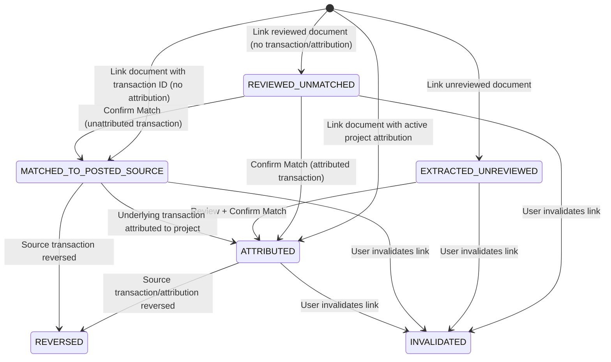

# FinSight Integration Contract: C05 OCR Expense Review & Project Financial Evidence Linkage

**Document Reference:** `docs/integration/dev-a/c05/C05_OCR_PROJECT_EVIDENCE_CONTRACT.md`
**Version:** `1.0.0`
**Date:** 2026-11-09
**Owners:**
- **Developer A (Antigravity):** Financial Subledger, Obligations, Attributions & Commitments Coordinator
- **Developer B (Fatima):** OCR Review UI, Document Extraction & Commercial Documents Domain Owner

---

## 1. Cardinal Architectural Rule

> [!IMPORTANT]
> **"OCR evidence is documentary proof, NOT cash authority."**
> Under no circumstances does attaching, reviewing, or matching an OCR receipt:
> 1. Mutate cash or bank balances.
> 2. Create financial transactions or journal ledger entries.
> 3. Create or modify payables or receivables.
> 4. Consume project cash headroom independently.
>
> Authoritative cash actuals and headroom are dictated **solely** by posted financial transactions (`financial_transactions`) and their project attributions (`project_financial_attributions`). OCR receipts provide documentary verification and audit provenance.

---

## 2. Domain Ownership & Boundaries

| Domain / Entity | Owner | Responsibilities & Boundaries |
|:---|:---|:---|
| **Document Ingestion & OCR Review** (`uploaded_documents`, `document_corrections`) | **Developer B** | Document upload, OCR extraction, document review, correction provenance, and status transitions (`extracted`, `needs_review`, `confirmed`). Non-posting document domain. |
| **Project Financial Attributions** (`project_financial_attributions`) | **Developer A** | Canonical cash, commission, and FX cost attributions to projects. Dictates project cash actuals and cash headroom. |
| **Project OCR Evidence Links** (`project_ocr_evidence_links`) | **Developer A** | Additive link table associating OCR documents with projects and financial transactions/attributions. Enforces deduplication warnings, discrepancy tracking, and soft-invalidation. |
| **Financial Subledger & Transactions** (`financial_transactions`, `financial_accounts`) | **Developer A** | Authoritative cash movements, account balances, and idempotent posting. |

---

## 3. Evidence Status Lifecycle & Transition Model

Each linked OCR document is tracked via `project_ocr_evidence_links.evidence_status`:



### Status Descriptions:
- **`EXTRACTED_UNREVIEWED`**: Document uploaded and raw OCR extracted, but not yet human-reviewed.
- **`REVIEWED_UNMATCHED`**: Human-reviewed document linked to project as supporting evidence, but not yet linked to a posted cash payment.
- **`MATCHED_TO_POSTED_SOURCE`**: Linked to a posted financial transaction in the business, but that transaction has not been attributed to this project under C05A.
- **`ATTRIBUTED`**: Fully verified documentary proof backing an authoritative project cash attribution.
- **`REVERSED`**: The matched source financial transaction was reversed via `TransactionReverseService`. Preserves full historical audit audit trail.
- **`INVALIDATED`**: User soft-invalidated the link. Preserves row for audit integrity (`invalidated_at`, `invalidated_by`, `invalidation_reason`).

---

## 4. Deduplication & Discrepancy Detection

### A. Multi-Project Split & Duplicate Evidence Warning
A single commercial receipt or invoice (e.g. bulk raw materials, utility bill) may legitimately service multiple projects. FinSight detects when a document is linked across projects:
- Candidate listing calculates `alreadyLinkedProjectCount = count(distinct project_id)`.
- If `alreadyLinkedProjectCount >= 1`, candidate and active links display:
  `🔗 Split across multiple projects (N)`
- Deduplication logic ensures the document cannot be re-linked with active status to the **same** project twice.

### B. Amount Discrepancy Detection
Receipt amounts often differ from posted bank debits (due to bank transfer fees, partial cash payments, withholding tax, or roundoffs):
- If `|ocr_amount - matched_transaction_amount| > 0`:
  - `has_discrepancy = true`
  - `discrepancy_amount = |ocr_amount - matched_transaction_amount|`
  - UI displays: `⚠️ Discrepancy: PKR X,XXX.XX`
- **Non-Mutating Invariant:** Under no circumstances does FinSight alter either the OCR receipt amount or the posted ledger amount to force a match. Both values remain immutable, and the discrepancy is logged for human review.

---

## 5. Security & Immutability Discipline

1. **Least-Privilege Role Security (V44 Migration):**
   ```sql
   REVOKE DELETE ON TABLE project_ocr_evidence_links FROM finsight_app;
   GRANT SELECT, INSERT, UPDATE ON TABLE project_ocr_evidence_links TO finsight_app;
   GRANT SELECT ON TABLE project_ocr_evidence_links TO finsight_backup;
   ```
   Physical deletion is permanently forbidden for runtime application connections.
2. **Soft Invalidation Only:**
   Links can only transition to `INVALIDATED` with mandatory audit fields:
   `invalidated_at`, `invalidated_by`, `invalidation_reason`.
3. **Foreign Key Integrity:**
   `business_id` is validated server-side via `ActiveBusinessContext`. Foreign keys enforce `(business_id, project_id) -> projects(business_id, id)` and `(user_id, document_id) -> uploaded_documents(user_id, id)`.

---

## 6. Verification & Test Evidence

| Verification Tier | Scope | Target Suite | Status |
|:---|:---|:---|:---|
| **Database Migrations** | V42, V43, V44 schema, constraints, role grants | PostgreSQL 17 / Testcontainers | **100% Passed** |
| **Backend Integration Tests** | Fixtures A–G (Linking, Splits, Discrepancies, Invalidation, Reversals, Role Permissions) | `ProjectOcrEvidencePostgreSqlIT.java` (7/7 tests) | **7/7 Passed** |
| **Full C05 Backend Suite** | C05A, C05B, C05C Integration Tests | `ProjectAttributionPostgreSqlIT`, `ProjectCommitmentPostgreSqlIT`, `ProjectOcrEvidencePostgreSqlIT` | **21/21 Passed** |
| **Frontend Unit & Component Tests** | Translations, API client, Card, Dialogs | `frontend/tests/project-actuals.test.mjs` + Full Suite | **416/416 Passed** |
| **Browser Integration Journeys** | Real Spring Boot + Next.js + Playwright Live Execution (20 Journeys) | `frontend/tests/project-ocr-evidence-browser.integration.mjs` | **20/20 Passed** |
