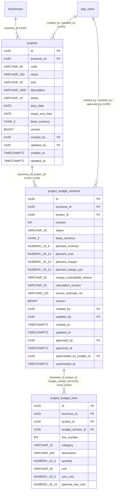

# F05 — Project, Job and Order Finance: Phase A Implementation Plan (Project Planning + Budgeting Foundation)

* **Date:** 25 October 2026 (Asia/Karachi)
* **Feature / Slice:** F05 — Project, Job and Order Finance (**Phase A Only: Project Planning + Budgeting Foundation**)
* **Feature Lead / Reviewer:** Developer B (full-stack lead) / Developer A (cross-domain financial reviewer)
* **Authoritative Source Branch & Base SHA:** `dev/fatima` at `ea8e812f1d891c07362883a4374754e48485c884`
* **Isolated Worktree:** `C:/Users/Hp/FYP/wt-f05-phase-a` (branch `codex/f05-project-planning-phase-a`, based strictly on `ea8e812f1d891c07362883a4374754e48485c884`)
* **Gate Status:** **IMPLEMENTED & LOCALLY VERIFIED (`V30__project_planning_foundation.sql`)** on isolated worktree `C:/Users/Hp/FYP/wt-f05-phase-a` (base `ea8e812f1d891c07362883a4374754e48485c884`). See [F05_PHASE_A_IMPLEMENTATION.md](F05_PHASE_A_IMPLEMENTATION.md) for final delivered contract.

---

## 1. Exact Phase A Scope

Phase A delivers the **Project Planning + Budgeting Foundation** for F05. All figures in this slice are explicitly **PLANNED**. It provides an authenticated, business-scoped SME workflow to:

1. **Create a canonical planning record (`Project`)** within the active business context (`UUID businessId` and `UUID userId` resolved exclusively on the server via `BusinessAuthorizationService`).
2. **Choose the business-facing terminology label (`kind`)** — `PROJECT`, `JOB`, or `ORDER` — around one unified financial planning model rather than three separate domain implementations.
3. **Maintain project metadata and planning dates:**
   * Business-scoped unique `code` (`(business_id, code)` normalized to uppercase ASCII).
   * `name`, optional `description`, optional `startDate`, and optional `targetEndDate` (enforcing `targetEndDate >= startDate` when both are provided).
   * Bounded single-currency MVP planning assumption (`PKR` / `currencyBasis: "APPLICATION_FIXED_PKR"`), matching actual current repository conventions (`PricingCalculator.java` / `F06_IMPLEMENTATION.md`), since no selectable business currency field exists in `businesses`, `business_profiles`, or `business_configuration`.
4. **Construct versioned planned budgets (`ProjectBudgetVersion` + `ProjectBudgetLine`):**
   * Enter `plannedRevenue` and 1–100 planned cost lines across the five conceptual planning categories (`MATERIAL`, `LABOUR`, `OVERHEAD`, `FREIGHT`, `OTHER`), reusing the F06 category vocabulary without modifying F06 source.
   * Compute authoritative `plannedLineCost`, category subtotals, `plannedCost`, `plannedMargin`, and `plannedMarginPct` on the backend using `BigDecimal`.
5. **Version, revise, discard drafts, and approve budgets:**
   * Allow at most **one** open `DRAFT` budget revision and at most **one** active `APPROVED` budget revision per project at any time.
   * Save, edit in-place (`PUT`), or discard (`DELETE`) an unapproved `DRAFT` budget version under optimistic concurrency control.
   * Approve a `DRAFT` budget version (`DRAFT -> APPROVED`), recording `approved_by` and `approved_at`.
   * Enforce **single active approved budget**: approving a newer revision atomically transitions the previously `APPROVED` version to `SUPERSEDED` (`APPROVED -> SUPERSEDED`, recording `superseded_by_budget_id` and `superseded_at`) in a single database transaction.
   * Enforce **strict immutability of `APPROVED` and `SUPERSEDED` budget versions and their cost lines**: revising a project's budget creates a new `ProjectBudgetVersion` (`revision = max(revision) + 1`) rather than overwriting approved history.
6. **Inspect planned financial summary and budget revision history:**
   * Compare `plannedRevenue` to `plannedCost`, inspect `plannedMargin` and `plannedMarginPct` (with explicit `ZERO_PLANNED_REVENUE` unavailability reason when `plannedRevenue == 0`), and review all historical budget revisions (`DRAFT`, `APPROVED`, `SUPERSEDED`).
7. **Manage project planning lifecycle (`DRAFT`, `ACTIVE`, `COMPLETED`, `CANCELLED`, `ARCHIVED`) and intentional draft cleanup:**
   * Allow deleting a `DRAFT` project **only** when it is still in `DRAFT` status and has never had an `APPROVED` or `SUPERSEDED` budget version.
   * Close or archive projects (`COMPLETED`, `CANCELLED`, `ARCHIVED`) without deleting project metadata or approved/superseded budget history.

---

## 2. Non-Goals (Explicit Phase A Exclusions)

Phase A is **strictly a non-posting planning and budgeting foundation**. It does **not** implement actual project profitability or any cross-domain financial posting:

* **No recognized project revenue:** Does not compute or store `recognizedRevenue` or link issued invoices (`F04`).
* **No actual project cost attribution:** Does not create `project_attributions` or attribute actual expenses, bills, stock issues, or payroll.
* **No C01 ledger events or C02 monthly projections:** Creates zero ledger events, account movements, or monthly projection updates.
* **No C04 receivables, payables, or invoice settlements:** Creates zero counterparty obligations, payment allocations, or advances; `projects` has no counterparty/customer FK in Phase A because `C04` (`counterparties`) does not yet exist in the repository schema.
* **No cash receipt or cash outflow attribution:** Does not track `cashReceived` or `cashPaid`.
* **No F08/C07 inventory consumption or COGS attribution:** Does not issue stock, calculate WAC, or post COGS.
* **No F10/C08 commission calculation or salesperson row scope:** Does not calculate commissions or introduce a `SALESPERSON` role/predicate.
* **No F07/C06 funding-gap or dated cash-plan engine:** Does not calculate peak funding requirements, trough dates, or recovery dates.
* **No F11/C09 FX or tax engines:** Does not invent a business currency selector, infer currency from browser locale, perform FX conversions, or compute tax.
* **No actual-versus-budget comparison:** Does not compute `budgetVariance` (`plannedCost - actualCost`) or `revenueVariance`, and never fabricates zero actuals to simulate variance.
* **No `MonthlyRecord` or `ScoringService` mutation:** Never reads, distributes, or mutates `monthly_records`, `document_financial_contributions`, `score_results`, `insights`, or `recommendations`. Never infers project margins from business-wide monthly snapshots.
* **No F06 source modification or conversion:** Does not modify any file in `backend/.../estimates/` or `frontend/.../estimates/`, and does not implement estimate-to-project conversion (F06 is currently a stateless preview slice without persisted estimates).
* **No `ModuleRegistry` or F13 dashboard widget activation:** Does not mark `projects` as `implemented = true` in `ModuleRegistry` and does not enable `projects`, `budgets`, or `funding-gap` widgets in `WidgetRegistry`.
* **No fake persistence or in-memory production stub:** Does not register an in-memory repository or expose live navigation links before the database migration is reserved and applied.

---

## 3. Source Reuse

Phase A reuses the repository's verified architecture directly from `dev/fatima` (`ea8e812f1d891c07362883a4374754e48485c884`):

| Existing Source Path | How Phase A Reuses It |
|---|---|
| [`ActiveBusinessContext.java`](file:///C:/Users/Hp/FYP/wt-f05-phase-a/backend/src/main/java/com/app/sme_health_backend/identity/service/ActiveBusinessContext.java) & [`BusinessAccessContext.java`](file:///C:/Users/Hp/FYP/wt-f05-phase-a/backend/src/main/java/com/app/sme_health_backend/identity/dto/BusinessAccessContext.java) | Resolves the authenticated human actor (`UUID context.userId()`), active tenant (`UUID context.businessId()`), and active `MembershipRole` (`context.role()`) from the server session. |
| [`BusinessAuthorizationService.java`](file:///C:/Users/Hp/FYP/wt-f05-phase-a/backend/src/main/java/com/app/sme_health_backend/identity/service/BusinessAuthorizationService.java), [`BusinessPermission.java`](file:///C:/Users/Hp/FYP/wt-f05-phase-a/backend/src/main/java/com/app/sme_health_backend/identity/model/BusinessPermission.java) & [`MembershipRole.java`](file:///C:/Users/Hp/FYP/wt-f05-phase-a/backend/src/main/java/com/app/sme_health_backend/identity/model/MembershipRole.java) | Enforces existing `BusinessPermission.FINANCIAL_DATA_READ` (reads) and `BusinessPermission.RECORD_CREATE_UPDATE` (writes, transitions, draft deletions, approvals) across the four actual `MembershipRole` values (`OWNER`, `ACCOUNTANT`, `MANAGER`, `VIEWER`) with zero changes to `BusinessPermission.java` or `BusinessAuthorizationService.java`. |
| [`SecurityAuditService.java`](file:///C:/Users/Hp/FYP/wt-f05-phase-a/backend/src/main/java/com/app/sme_health_backend/audit/service/SecurityAuditService.java) & [`AuditEventType.java`](file:///C:/Users/Hp/FYP/wt-f05-phase-a/backend/src/main/java/com/app/sme_health_backend/audit/model/AuditEventType.java) | Records mandatory transactional audit events (`Propagation.REQUIRED`, fail-closed) with human `actorUserId = context.userId()` and tenant `businessId = context.businessId()` (preserving R03 audit attribution invariants). |
| [`BusinessConfigurationRepository.java`](file:///C:/Users/Hp/FYP/wt-f05-phase-a/backend/src/main/java/com/app/sme_health_backend/configuration/repository/BusinessConfigurationRepository.java) | Reuses the parent-business row lock pattern (`SELECT id FROM businesses WHERE id = ? AND status = 'ACTIVE' FOR UPDATE`) via `JdbcTemplate` to serialize first-insert and code-uniqueness checks per business. |
| [`EstimateRequestReader.java`](file:///C:/Users/Hp/FYP/wt-f05-phase-a/backend/src/main/java/com/app/sme_health_backend/estimates/controller/EstimateRequestReader.java) & [`EstimateDecimals.java`](file:///C:/Users/Hp/FYP/wt-f05-phase-a/backend/src/main/java/com/app/sme_health_backend/estimates/service/EstimateDecimals.java) | Follows the same closed-schema Jackson `JsonMapper` pattern (`STRICT_DUPLICATE_DETECTION`, `FAIL_ON_TRAILING_TOKENS`, 64 KB byte bound, no numeric-to-string coercion) and exact `BigDecimal` arithmetic in `projects/` without modifying `estimates/`. |
| [`client.ts`](file:///C:/Users/Hp/FYP/wt-f05-phase-a/frontend/src/lib/api/client.ts) & [`SessionProvider.tsx`](file:///C:/Users/Hp/FYP/wt-f05-phase-a/frontend/src/components/auth/SessionProvider.tsx) | Reuses cookie-only same-origin transport, `X-XSRF-TOKEN` acquisition, `Cache-Control: no-store`, generation-based request cancellation on business/session switch, and non-replayed mutations. |
| [`LivePage.tsx`](file:///C:/Users/Hp/FYP/wt-f05-phase-a/frontend/src/components/integration/LivePage.tsx) & `components/ui/*` | Reuses `LivePage`, `Card`, `Button`, `Input`, `Select`, `StatusBadge`, `EmptyState`, `ErrorState`, `useLanguage`, and `localizedError`. |

---

## 4. Proposed Classes and Files

### 4.1 Migration-Independent Classes Already Implemented and Tested in Worktree (`wt-f05-phase-a`)

| Layer | File Path | Responsibility |
|---|---|---|
| Backend Model | [`ProjectKind.java`](file:///C:/Users/Hp/FYP/wt-f05-phase-a/backend/src/main/java/com/app/sme_health_backend/projects/model/ProjectKind.java) | Terminology enum: `PROJECT`, `JOB`, `ORDER`. |
| Backend Model | [`ProjectStatus.java`](file:///C:/Users/Hp/FYP/wt-f05-phase-a/backend/src/main/java/com/app/sme_health_backend/projects/model/ProjectStatus.java) | Lifecycle enum (`DRAFT`, `ACTIVE`, `COMPLETED`, `CANCELLED`, `ARCHIVED`) with deterministic transition graph (`canTransitionTo`, `allowsPlanningMutations`, `canDeleteProject`). |
| Backend Model | [`ProjectBudgetStatus.java`](file:///C:/Users/Hp/FYP/wt-f05-phase-a/backend/src/main/java/com/app/sme_health_backend/projects/model/ProjectBudgetStatus.java) | Budget version status enum (`DRAFT`, `APPROVED`, `SUPERSEDED`), `isImmutable()`, and `canDeleteDraft()`. |
| Backend Model | [`ProjectCostCategory.java`](file:///C:/Users/Hp/FYP/wt-f05-phase-a/backend/src/main/java/com/app/sme_health_backend/projects/model/ProjectCostCategory.java) | Cost category enum (`MATERIAL`, `LABOUR`, `OVERHEAD`, `FREIGHT`, `OTHER`). |
| Backend DTO | [`ProjectCreateRequest.java`](file:///C:/Users/Hp/FYP/wt-f05-phase-a/backend/src/main/java/com/app/sme_health_backend/projects/dto/ProjectCreateRequest.java), [`ProjectUpdateRequest.java`](file:///C:/Users/Hp/FYP/wt-f05-phase-a/backend/src/main/java/com/app/sme_health_backend/projects/dto/ProjectUpdateRequest.java), [`ProjectTransitionRequest.java`](file:///C:/Users/Hp/FYP/wt-f05-phase-a/backend/src/main/java/com/app/sme_health_backend/projects/dto/ProjectTransitionRequest.java) | Closed-schema command records for project creation, update, and lifecycle transitions. |
| Backend DTO | [`ProjectBudgetLineRequest.java`](file:///C:/Users/Hp/FYP/wt-f05-phase-a/backend/src/main/java/com/app/sme_health_backend/projects/dto/ProjectBudgetLineRequest.java), [`ProjectBudgetRequest.java`](file:///C:/Users/Hp/FYP/wt-f05-phase-a/backend/src/main/java/com/app/sme_health_backend/projects/dto/ProjectBudgetRequest.java), [`ProjectBudgetApprovalRequest.java`](file:///C:/Users/Hp/FYP/wt-f05-phase-a/backend/src/main/java/com/app/sme_health_backend/projects/dto/ProjectBudgetApprovalRequest.java) | Closed-schema command records for draft budget creation, draft budget update, and budget approval. |
| Backend DTO | [`ProjectBudgetCalculationResponse.java`](file:///C:/Users/Hp/FYP/wt-f05-phase-a/backend/src/main/java/com/app/sme_health_backend/projects/dto/ProjectBudgetCalculationResponse.java) | Authoritative calculated budget result with exact decimal strings and raw `BigDecimal` values. |
| Backend Service | [`ProjectDecimals.java`](file:///C:/Users/Hp/FYP/wt-f05-phase-a/backend/src/main/java/com/app/sme_health_backend/projects/service/ProjectDecimals.java), [`ProjectValidationException.java`](file:///C:/Users/Hp/FYP/wt-f05-phase-a/backend/src/main/java/com/app/sme_health_backend/projects/service/ProjectValidationException.java), [`ProjectBudgetCalculator.java`](file:///C:/Users/Hp/FYP/wt-f05-phase-a/backend/src/main/java/com/app/sme_health_backend/projects/service/ProjectBudgetCalculator.java) | Stateless `BigDecimal` budget calculator and metadata/date/code validator enforcing field-specific bounded precision (`plannedRevenue` `1..12` whole / `0..4` frac, `quantity` `1..9` whole / `0..6` frac, `unitCost` `1..12` whole / `0..6` frac, `DIVISION_SCALE = 12`). |
| Backend Controller Support | [`ProjectRequestReader.java`](file:///C:/Users/Hp/FYP/wt-f05-phase-a/backend/src/main/java/com/app/sme_health_backend/projects/controller/ProjectRequestReader.java) | Strict closed-schema JSON request reader rejecting unknown fields, numeric tokens on decimal strings, duplicate keys, trailing tokens, and bodies > 65,536 bytes. |
| Backend Tests | [`ProjectBudgetCalculatorTests.java`](file:///C:/Users/Hp/FYP/wt-f05-phase-a/backend/src/test/java/com/app/sme_health_backend/projects/ProjectBudgetCalculatorTests.java), [`ProjectRequestReaderTests.java`](file:///C:/Users/Hp/FYP/wt-f05-phase-a/backend/src/test/java/com/app/sme_health_backend/projects/ProjectRequestReaderTests.java), [`ProjectLifecycleTests.java`](file:///C:/Users/Hp/FYP/wt-f05-phase-a/backend/src/test/java/com/app/sme_health_backend/projects/ProjectLifecycleTests.java) | 42 deterministic unit tests covering calculations, zero revenue, fractional quantities, field-specific precision bounds, categories, closed JSON parsing, lifecycle transitions, and draft deletion eligibility. |
| Frontend Helpers & Copy | [`form.ts`](file:///C:/Users/Hp/FYP/wt-f05-phase-a/frontend/src/lib/projects/form.ts), [`projects.ts`](file:///C:/Users/Hp/FYP/wt-f05-phase-a/frontend/src/lib/i18n/translations/projects.ts), [`projects.test.mjs`](file:///C:/Users/Hp/FYP/wt-f05-phase-a/frontend/tests/projects.test.mjs) | Pure draft state, field-specific decimal validation, payload sanitizers, EN/UR money & percentage string formatters, bilingual dictionary, and AST-verified unit tests. |

### 4.2 Classes/Files to Add After Migration Reservation

| Layer | Proposed File Path | Responsibility |
|---|---|---|
| Migration | `backend/src/main/resources/db/migration/V30__project_planning_foundation.sql` | Additive DDL for `projects`, `project_budget_versions`, `project_budget_lines`, targeted immutability triggers, indexes, and role grants (`finsight_app`, `finsight_backup`). |
| Backend Model | `backend/src/main/java/com/app/sme_health_backend/projects/model/ProjectRecord.java` | Domain record mapping a row from `projects` (`UUID id`, `UUID businessId`, `UUID createdBy`, `UUID updatedBy`, etc.). |
| Backend Model | `backend/src/main/java/com/app/sme_health_backend/projects/model/ProjectBudgetVersionRecord.java` | Domain record mapping `project_budget_versions` (`UUID id`, `UUID businessId`, `UUID projectId`, etc.) and its ordered `ProjectBudgetLineRecord` items (`UUID id`). |
| Backend DTO | `backend/src/main/java/com/app/sme_health_backend/projects/dto/ProjectResponse.java` | API response DTO for a single project and its current approved/draft budget summary. |
| Backend DTO | `backend/src/main/java/com/app/sme_health_backend/projects/dto/ProjectListResponse.java` | Bounded list response `{ items: List<ProjectResponse> }`. |
| Backend DTO | `backend/src/main/java/com/app/sme_health_backend/projects/dto/ProjectBudgetVersionResponse.java` | API response DTO for a persisted budget version (`DRAFT`, `APPROVED`, `SUPERSEDED`), lines, category subtotals, and approval/supersession provenance. |
| Backend DTO | `backend/src/main/java/com/app/sme_health_backend/projects/dto/ProjectPlanningSummaryResponse.java` | API response DTO for `GET /api/projects/{id}/planning-summary`. |
| Backend Exception | `backend/src/main/java/com/app/sme_health_backend/projects/service/ProjectException.java` | Domain exception carrying HTTP status (400/403/404/409) and stable machine error code (`project_not_found`, `budget_not_found`, `duplicate_project_code`, `stale_project_version`, `stale_budget_version`, `invalid_project_transition`, `invalid_project_state`, `draft_budget_already_exists`, `open_draft_budget_exists`, `project_delete_forbidden`, `budget_immutable`, `invalid_budget_transition`). |
| Backend Repository | `backend/src/main/java/com/app/sme_health_backend/projects/repository/ProjectRepository.java` | `JdbcTemplate` repository for `projects` with business lock (`lockBusiness`), scoped row lock (`findForUpdate`), scoped queries, versioned updates, and draft-only deletion. |
| Backend Repository | `backend/src/main/java/com/app/sme_health_backend/projects/repository/ProjectBudgetRepository.java` | `JdbcTemplate` repository for `project_budget_versions` and `project_budget_lines` with deterministic `ORDER BY revision ASC, id ASC FOR UPDATE` locking, revision numbering, atomic supersession + approval, draft deletion, and line batch replacement. |
| Backend Service | `backend/src/main/java/com/app/sme_health_backend/projects/service/ProjectPlanningService.java` | Transactional service orchestrating project CRUD, draft project deletion, status transitions, draft budget CRUD/deletion, budget approval, planning summary assembly, and mandatory `SecurityAuditService` logging. |
| Backend Controller | `backend/src/main/java/com/app/sme_health_backend/projects/controller/ProjectController.java` | REST controller at `/api/projects` enforcing `BusinessPermission.FINANCIAL_DATA_READ` / `BusinessPermission.RECORD_CREATE_UPDATE`, byte-bounded `ProjectRequestReader` parsing, and `Cache-Control: no-store`. |
| Frontend API | `frontend/src/lib/api/projects.ts` | Typed `apiClient` wrappers for all `/projects` endpoints. |
| Frontend Components | `frontend/src/components/projects/{ProjectList,ProjectForm,ProjectDetailWorkspace,BudgetEditor,BudgetVersionHistory,PlannedFinancialSummary,BudgetApprovalDialog,ProjectTransitionDialog}.tsx` | Phase A UI components with explicit `PLANNED` badges on every money card, EN/UR/RTL layout, conflict reload banners, and keyboard/mobile accessibility. |
| Frontend Routes | `frontend/src/app/projects/page.tsx`, `frontend/src/app/projects/new/page.tsx`, `frontend/src/app/projects/[id]/page.tsx` | Next.js App Router pages for project list, creation, and detail/budget workspace. |

---

## 5. Exact Proposed Schema, UUID Identity & Numeric Precision Policy

### 5.1 UUID Identity & Composite Tenant-Scoped Foreign Key Strategy

Consistent with `V1__initial_schema.sql`, `V9__add_identity_and_authentication.sql`, `V18__business_configuration.sql`, `V19__dashboard_preferences.sql`, and `V29__monthly_record_integrity.sql`:
* `businesses.id` is `UUID`.
* `app_users.id` is `UUID`.
* `BusinessAccessContext.userId()` and `BusinessAccessContext.businessId()` are `UUID`.
* Therefore, **all primary keys (`projects.id`, `project_budget_versions.id`, `project_budget_lines.id`), all tenant foreign keys (`business_id`), all parent entity keys (`project_id`, `budget_version_id`, `superseded_by_budget_id`), and all actor references (`created_by`, `updated_by`, `approved_by`) are `UUID`** with `DEFAULT gen_random_uuid()` on primary keys.
* `BIGINT` is used solely for optimistic concurrency counters (`version BIGINT NOT NULL DEFAULT 0`), and `INT` is used for bounded ordinals (`revision` and `line_number`).
* Every child table enforces **composite tenant-scoped foreign keys**:
  * `projects` declares `UNIQUE (business_id, id)`.
  * `project_budget_versions` references `projects (business_id, id) ON DELETE RESTRICT`, declares `UNIQUE (business_id, project_id, id)`, and self-references `project_budget_versions (business_id, project_id, id) ON DELETE RESTRICT` for `superseded_by_budget_id`.
  * `project_budget_lines` references `project_budget_versions (business_id, project_id, id) ON DELETE CASCADE` so that discarding an unapproved `DRAFT` budget version automatically removes its draft lines while trigger enforcement prevents deleting `APPROVED` or `SUPERSEDED` versions or their lines.



### 5.2 Deliberate Bounded Numeric Precision Contract (Separating Calculation Precision from P10 Accounting Rounding)

Unlike stateless F06 previews (which accept 12 fractional digits on every input because they are never stored in PostgreSQL), persisted F05 Phase A budgets enforce a **deliberate, mathematically closed input and storage contract** that guarantees **zero database overflow** and **zero silent currency rounding**:

| Field / Column | Accepted Input / Formula | Max Integer Digits | Max Fractional Digits (Scale) | Exact Max Magnitude | PostgreSQL Type | Why This Exact `(p, s)` Is Required |
|---|---|---|---|---|---|---|
| `planned_revenue` | User input `[0-9]{1,12}(?:\.[0-9]{1,4})?` | `12` | `4` | `999,999,999,999.9999` ($< 10^{12}$) | `NUMERIC(16, 4)` | Matches the 12-whole-digit PKR ceiling of `monthly_records` (`NUMERIC(14,2)`) while allowing up to 4 fractional planning places without truncation (`12 + 4 = 16`). |
| `quantity` | User input `[0-9]{1,9}(?:\.[0-9]{1,6})?` | `9` | `6` | `999,999,999.999999` ($< 10^9$) | `NUMERIC(15, 6)` | Supports up to 1 billion units and 6 fractional places (milligrams, milliliters, fractional hours) without truncation (`9 + 6 = 15`). |
| `unit_cost` | User input `[0-9]{1,12}(?:\.[0-9]{1,6})?` | `12` | `6` | `999,999,999,999.999999` ($< 10^{12}$) | `NUMERIC(18, 6)` | Supports unit costs up to $< 10^{12}$ PKR and up to 6 fractional places for sub-paisa unit rates (`12 + 6 = 18`). |
| `planned_line_cost` | Exact `quantity × unit_cost` | `21` ($9 + 12$) | `12` ($6 + 6$) | $< 10^{21}$ | `NUMERIC(33, 12)` | Product of a 9-whole/6-frac number and a 12-whole/6-frac number has at most $9 + 12 = 21$ whole digits and $6 + 6 = 12$ fractional digits (`21 + 12 = 33`). Any scale `< 12` would cause PostgreSQL to **silently round** `quantity * unit_cost` on `INSERT`. |
| `planned_cost` | Exact $\sum_{i=1}^{n} \text{planned\_line\_cost}_i$ ($1 \le n \le 100$) | `23` ($21 + 2$) | `12` | $< 100 \times 10^{21} = 10^{23}$ | `NUMERIC(35, 12)` | Summing up to 100 lines adds at most 2 whole digits ($21 + 2 = 23$) and preserves the exact scale of `12` (`23 + 12 = 35`) with zero rounding. |
| `planned_margin` | Exact `planned_revenue - planned_cost` | `23` | `12` ($\max(4, 12)$) | $\in (-10^{23}, 10^{12})$ | `NUMERIC(35, 12)` | Exact difference between `NUMERIC(16,4)` and `NUMERIC(35,12)` has at most 23 whole digits and 12 fractional digits (`23 + 12 = 35`). |
| `planned_margin_pct` | `planned_margin / planned_revenue` when `planned_revenue > 0` (`scale = 12`, `HALF_EVEN`) | `27` ($23 - (-4)$) | `12` | $< 10^{23} / 10^{-4} = 10^{27}$ | `NUMERIC(39, 12)` | Minimum positive `planned_revenue` is $0.0001 = 10^{-4}$; dividing max magnitude $< 10^{23}$ by $10^{-4}$ yields $< 10^{27}$ (at most 27 whole digits) plus 12 fractional digits (`27 + 12 = 39`), preventing any possible division overflow. |

* **How JSON strings preserve exact values:**
  * Every decimal field in requests and responses is serialized as a JSON string (`"1000.00"`, `"15.43125"`, `"0.166666666667"`), never a JSON number.
  * When reading `BigDecimal` values from PostgreSQL `NUMERIC(p, s)` columns, [`ProjectDecimals.amount`](file:///C:/Users/Hp/FYP/wt-f05-phase-a/backend/src/main/java/com/app/sme_health_backend/projects/service/ProjectDecimals.java) strips trailing storage zeros (`stripTrailingZeros()`) and pads at least 2 fractional digits (`setScale(Math.max(2, stripped.scale()))`), while [`ProjectDecimals.decimal`](file:///C:/Users/Hp/FYP/wt-f05-phase-a/backend/src/main/java/com/app/sme_health_backend/projects/service/ProjectDecimals.java) strips trailing zeros (`stripTrailingZeros().toPlainString()`). Thus `"600.000000000000"` in `NUMERIC(33, 12)` returns `"600.00"` and `"15.431250000000"` returns `"15.43125"`, preserving every significant digit without exposing raw storage padding.
* **Interaction with future approved accounting rounding (`P10`):**
  * `project_budget_versions` records `calculation_version = 'f05-plan-v1'`, and API responses disclose `divisionScale: 12`, `divisionRounding: "HALF_EVEN"`, `accountingRoundingPolicy: null`.
  * No minor-unit currency quantization is performed in Phase A. When `P10` (base/original currency, minor-unit scale, line vs. document rounding, residual allocation) is later approved by Developer A and Developer B, posted commercial documents (`F04`) and actual ledger postings (`C01`) will apply `P10` while historical Phase A budget versions remain immutable under `f05-plan-v1`.

### 5.3 Currency Policy (Truthful Phase A Boundary)

* **Actual source verification:** Neither `businesses` (`V9`/`V17`), `business_profiles` (`V1`/`V2`), nor `business_configuration` (`V18`) contains a `base_currency` column or configurable currency setting in `dev/fatima`.
* **Phase A policy:**
  * F05 Phase A does **not** claim `BusinessConfiguration` provides `baseCurrency`, does **not** add a currency selector to `businesses`, does **not** accept currency from client request JSON, does **not** infer currency from browser locale, and does **not** implement F11/C09 multi-currency or FX behavior.
  * Instead, `projects.base_currency` and `project_budget_versions.base_currency` store the fixed constant `'PKR'` (`CHAR(3) NOT NULL DEFAULT 'PKR' CHECK (base_currency = 'PKR')`), and API responses return `baseCurrency: "PKR"` and `currencyBasis: "APPLICATION_FIXED_PKR"` (matching F06's `PricingCalculator.java`).
  * This is explicitly documented as a bounded single-currency MVP planning assumption until F11/C09 is implemented.

---

## 6. Exact Required Migration Content (`V30__project_planning_foundation.sql`)

> [!IMPORTANT]
> `V30__project_planning_foundation.sql` is explicitly reserved in `docs/phase2/IMPLEMENTATION_STATE.md` for F05 Phase A.

```sql
-- F05 Phase A: Project, Job and Order Planning + Budgeting Foundation.
-- All amounts in these tables are PLANNED. No actual revenue, actual cost attribution,
-- ledger event, MonthlyRecord mutation, or health-score change is performed.

CREATE TABLE projects (
    id UUID PRIMARY KEY DEFAULT gen_random_uuid(),
    business_id UUID NOT NULL REFERENCES businesses(id),
    code VARCHAR(40) NOT NULL,
    name VARCHAR(160) NOT NULL,
    kind VARCHAR(16) NOT NULL CHECK (kind IN ('PROJECT', 'JOB', 'ORDER')),
    description VARCHAR(1000) NULL,
    status VARCHAR(16) NOT NULL DEFAULT 'DRAFT'
        CHECK (status IN ('DRAFT', 'ACTIVE', 'COMPLETED', 'CANCELLED', 'ARCHIVED')),
    start_date DATE NULL,
    target_end_date DATE NULL,
    base_currency CHAR(3) NOT NULL DEFAULT 'PKR' CHECK (base_currency = 'PKR'),
    version BIGINT NOT NULL DEFAULT 0 CHECK (version >= 0),
    created_by UUID NOT NULL REFERENCES app_users(id),
    updated_by UUID NOT NULL REFERENCES app_users(id),
    created_at TIMESTAMPTZ NOT NULL DEFAULT now(),
    updated_at TIMESTAMPTZ NOT NULL DEFAULT now(),
    CONSTRAINT uq_projects_scoped_identity UNIQUE (business_id, id),
    CONSTRAINT uq_projects_business_code UNIQUE (business_id, code),
    CONSTRAINT chk_projects_code_normalized CHECK (
        btrim(code) <> ''
        AND code = upper(btrim(code))
        AND code ~ '^[A-Z0-9][A-Z0-9._/-]{0,39}$'
    ),
    CONSTRAINT chk_projects_name_nonblank CHECK (btrim(name) <> ''),
    CONSTRAINT chk_projects_description_nonblank CHECK (description IS NULL OR btrim(description) <> ''),
    CONSTRAINT chk_projects_dates CHECK (
        target_end_date IS NULL OR start_date IS NULL OR target_end_date >= start_date
    )
);

CREATE INDEX idx_projects_business_status_updated
    ON projects (business_id, status, updated_at DESC, id);
CREATE INDEX idx_projects_business_kind_updated
    ON projects (business_id, kind, updated_at DESC, id);

CREATE TABLE project_budget_versions (
    id UUID PRIMARY KEY DEFAULT gen_random_uuid(),
    business_id UUID NOT NULL REFERENCES businesses(id),
    project_id UUID NOT NULL,
    revision INT NOT NULL CHECK (revision > 0),
    status VARCHAR(16) NOT NULL DEFAULT 'DRAFT'
        CHECK (status IN ('DRAFT', 'APPROVED', 'SUPERSEDED')),
    base_currency CHAR(3) NOT NULL DEFAULT 'PKR' CHECK (base_currency = 'PKR'),
    planned_revenue NUMERIC(16, 4) NOT NULL CHECK (planned_revenue >= 0),
    planned_cost NUMERIC(35, 12) NOT NULL CHECK (planned_cost >= 0),
    planned_margin NUMERIC(35, 12) NOT NULL,
    planned_margin_pct NUMERIC(39, 12) NULL,
    margin_unavailable_reason VARCHAR(32) NULL
        CHECK (margin_unavailable_reason IN ('ZERO_PLANNED_REVENUE')),
    calculation_version VARCHAR(32) NOT NULL DEFAULT 'f05-plan-v1',
    source_estimate_ref VARCHAR(120) NULL,
    version BIGINT NOT NULL DEFAULT 0 CHECK (version >= 0),
    created_by UUID NOT NULL REFERENCES app_users(id),
    updated_by UUID NOT NULL REFERENCES app_users(id),
    created_at TIMESTAMPTZ NOT NULL DEFAULT now(),
    updated_at TIMESTAMPTZ NOT NULL DEFAULT now(),
    approved_by UUID NULL REFERENCES app_users(id),
    approved_at TIMESTAMPTZ NULL,
    superseded_by_budget_id UUID NULL,
    superseded_at TIMESTAMPTZ NULL,
    CONSTRAINT uq_project_budget_versions_scoped_identity UNIQUE (business_id, project_id, id),
    CONSTRAINT uq_project_budget_versions_business_id UNIQUE (business_id, id),
    CONSTRAINT uq_project_budget_versions_revision UNIQUE (business_id, project_id, revision),
    CONSTRAINT fk_project_budget_versions_project
        FOREIGN KEY (business_id, project_id) REFERENCES projects (business_id, id) ON DELETE RESTRICT,
    CONSTRAINT fk_project_budget_versions_superseded_by
        FOREIGN KEY (business_id, project_id, superseded_by_budget_id)
        REFERENCES project_budget_versions (business_id, project_id, id) ON DELETE RESTRICT,
    CONSTRAINT chk_project_budget_margin_equation
        CHECK (planned_margin = planned_revenue - planned_cost),
    CONSTRAINT chk_project_budget_zero_revenue_margin_pct CHECK (
        (planned_revenue = 0 AND planned_margin_pct IS NULL AND margin_unavailable_reason = 'ZERO_PLANNED_REVENUE')
        OR (planned_revenue > 0 AND planned_margin_pct IS NOT NULL AND margin_unavailable_reason IS NULL)
    ),
    CONSTRAINT chk_project_budget_approval_state CHECK (
        (status = 'DRAFT'
            AND approved_by IS NULL
            AND approved_at IS NULL
            AND superseded_by_budget_id IS NULL
            AND superseded_at IS NULL)
        OR (status = 'APPROVED'
            AND approved_by IS NOT NULL
            AND approved_at IS NOT NULL
            AND superseded_by_budget_id IS NULL
            AND superseded_at IS NULL)
        OR (status = 'SUPERSEDED'
            AND approved_by IS NOT NULL
            AND approved_at IS NOT NULL
            AND superseded_by_budget_id IS NOT NULL
            AND superseded_by_budget_id <> id
            AND superseded_at IS NOT NULL)
    )
);

-- Enforce at most ONE active APPROVED budget per project at a time:
CREATE UNIQUE INDEX uq_project_budget_versions_one_approved
    ON project_budget_versions (business_id, project_id)
    WHERE status = 'APPROVED';

-- Enforce at most ONE open DRAFT budget per project at a time:
CREATE UNIQUE INDEX uq_project_budget_versions_one_draft
    ON project_budget_versions (business_id, project_id)
    WHERE status = 'DRAFT';

CREATE INDEX idx_project_budget_versions_project_revision
    ON project_budget_versions (business_id, project_id, revision DESC);

CREATE TABLE project_budget_lines (
    id UUID PRIMARY KEY DEFAULT gen_random_uuid(),
    business_id UUID NOT NULL REFERENCES businesses(id),
    project_id UUID NOT NULL,
    budget_version_id UUID NOT NULL,
    line_number INT NOT NULL CHECK (line_number >= 1 AND line_number <= 100),
    category VARCHAR(16) NOT NULL
        CHECK (category IN ('MATERIAL', 'LABOUR', 'OVERHEAD', 'FREIGHT', 'OTHER')),
    description VARCHAR(200) NOT NULL CHECK (btrim(description) <> ''),
    quantity NUMERIC(15, 6) NOT NULL CHECK (quantity >= 0),
    unit VARCHAR(40) NOT NULL CHECK (btrim(unit) <> ''),
    unit_cost NUMERIC(18, 6) NOT NULL CHECK (unit_cost >= 0),
    planned_line_cost NUMERIC(33, 12) NOT NULL
        CHECK (planned_line_cost >= 0 AND planned_line_cost = quantity * unit_cost),
    CONSTRAINT uq_project_budget_lines_order UNIQUE (business_id, budget_version_id, line_number),
    CONSTRAINT fk_project_budget_lines_budget
        FOREIGN KEY (business_id, project_id, budget_version_id)
        REFERENCES project_budget_versions (business_id, project_id, id) ON DELETE CASCADE
);

CREATE INDEX idx_project_budget_lines_budget
    ON project_budget_lines (business_id, budget_version_id, line_number);
CREATE INDEX idx_project_budget_lines_project_category
    ON project_budget_lines (business_id, project_id, category);

-- Intentional history & draft-cleanup trigger:
-- 1. TRUNCATE is forbidden on all three tables.
-- 2. Projects can only be deleted when status = 'DRAFT' AND no APPROVED/SUPERSEDED budget version exists;
--    non-DRAFT projects or projects with approved history must use CANCELLED or ARCHIVED.
-- 3. DRAFT budget versions may be updated or deleted; APPROVED and SUPERSEDED budget versions can never be deleted.
-- 4. APPROVED budget versions are immutable except for the atomic transition status: 'APPROVED' -> 'SUPERSEDED'.
-- 5. SUPERSEDED budget versions are completely immutable.
-- 6. Budget lines belonging to an APPROVED or SUPERSEDED budget version cannot be inserted, updated, or deleted.
CREATE FUNCTION enforce_project_planning_immutability() RETURNS TRIGGER AS $$
DECLARE
    parent_status VARCHAR(16);
    has_immutable_history BOOLEAN;
BEGIN
    IF TG_OP = 'TRUNCATE' THEN
        RAISE EXCEPTION 'Project planning tables cannot be truncated'
            USING ERRCODE = '55000';
    END IF;

    IF TG_TABLE_NAME = 'projects' THEN
        IF TG_OP = 'DELETE' THEN
            IF OLD.status <> 'DRAFT' THEN
                RAISE EXCEPTION 'Only DRAFT projects can be deleted; transition non-draft projects to CANCELLED or ARCHIVED'
                    USING ERRCODE = '55000';
            END IF;
            SELECT EXISTS (
                SELECT 1
                FROM project_budget_versions
                WHERE business_id = OLD.business_id
                  AND project_id = OLD.id
                  AND status IN ('APPROVED', 'SUPERSEDED')
            ) INTO has_immutable_history;
            IF has_immutable_history THEN
                RAISE EXCEPTION 'Projects with approved budget history cannot be deleted; transition to CANCELLED or ARCHIVED'
                    USING ERRCODE = '55000';
            END IF;
            RETURN OLD;
        END IF;

        IF TG_OP = 'UPDATE' AND (
            NEW.id IS DISTINCT FROM OLD.id
            OR NEW.business_id IS DISTINCT FROM OLD.business_id
            OR NEW.created_by IS DISTINCT FROM OLD.created_by
            OR NEW.created_at IS DISTINCT FROM OLD.created_at
            OR NEW.version <= OLD.version
            OR OLD.status = 'ARCHIVED'
        ) THEN
            RAISE EXCEPTION 'Project identity, creation provenance, archived state, and monotonic version are immutable'
                USING ERRCODE = '55000';
        END IF;
        RETURN NEW;
    END IF;

    IF TG_TABLE_NAME = 'project_budget_versions' THEN
        IF TG_OP = 'DELETE' THEN
            IF OLD.status <> 'DRAFT' THEN
                RAISE EXCEPTION 'Approved and superseded project budget versions are permanent history and cannot be deleted'
                    USING ERRCODE = '55000';
            END IF;
            RETURN OLD;
        END IF;

        IF TG_OP = 'UPDATE' THEN
            IF OLD.status = 'SUPERSEDED' THEN
                RAISE EXCEPTION 'Superseded project budget versions are immutable'
                    USING ERRCODE = '55000';
            END IF;
            IF OLD.status = 'APPROVED' THEN
                IF NEW.status <> 'SUPERSEDED'
                   OR NEW.id IS DISTINCT FROM OLD.id
                   OR NEW.business_id IS DISTINCT FROM OLD.business_id
                   OR NEW.project_id IS DISTINCT FROM OLD.project_id
                   OR NEW.revision IS DISTINCT FROM OLD.revision
                   OR NEW.base_currency IS DISTINCT FROM OLD.base_currency
                   OR NEW.planned_revenue IS DISTINCT FROM OLD.planned_revenue
                   OR NEW.planned_cost IS DISTINCT FROM OLD.planned_cost
                   OR NEW.planned_margin IS DISTINCT FROM OLD.planned_margin
                   OR NEW.planned_margin_pct IS DISTINCT FROM OLD.planned_margin_pct
                   OR NEW.margin_unavailable_reason IS DISTINCT FROM OLD.margin_unavailable_reason
                   OR NEW.calculation_version IS DISTINCT FROM OLD.calculation_version
                   OR NEW.source_estimate_ref IS DISTINCT FROM OLD.source_estimate_ref
                   OR NEW.created_by IS DISTINCT FROM OLD.created_by
                   OR NEW.created_at IS DISTINCT FROM OLD.created_at
                   OR NEW.approved_by IS DISTINCT FROM OLD.approved_by
                   OR NEW.approved_at IS DISTINCT FROM OLD.approved_at
                   OR NEW.version <> OLD.version + 1 THEN
                    RAISE EXCEPTION 'Approved project budget versions are immutable except for atomic supersession'
                        USING ERRCODE = '55000';
                END IF;
            END IF;
        END IF;
        RETURN NEW;
    END IF;

    IF TG_TABLE_NAME = 'project_budget_lines' THEN
        SELECT status INTO parent_status
        FROM project_budget_versions
        WHERE business_id = COALESCE(NEW.business_id, OLD.business_id)
          AND project_id = COALESCE(NEW.project_id, OLD.project_id)
          AND id = COALESCE(NEW.budget_version_id, OLD.budget_version_id);
        IF parent_status IN ('APPROVED', 'SUPERSEDED') THEN
            RAISE EXCEPTION 'Lines of an approved or superseded budget version are immutable'
                USING ERRCODE = '55000';
        END IF;
        IF TG_OP = 'DELETE' THEN
            RETURN OLD;
        END IF;
        RETURN NEW;
    END IF;

    RETURN NULL;
END;
$$ LANGUAGE plpgsql;

CREATE TRIGGER trg_projects_immutability
    BEFORE UPDATE OR DELETE ON projects
    FOR EACH ROW EXECUTE FUNCTION enforce_project_planning_immutability();
CREATE TRIGGER trg_projects_no_truncate
    BEFORE TRUNCATE ON projects
    FOR EACH STATEMENT EXECUTE FUNCTION enforce_project_planning_immutability();

CREATE TRIGGER trg_project_budget_versions_immutability
    BEFORE UPDATE OR DELETE ON project_budget_versions
    FOR EACH ROW EXECUTE FUNCTION enforce_project_planning_immutability();
CREATE TRIGGER trg_project_budget_versions_no_truncate
    BEFORE TRUNCATE ON project_budget_versions
    FOR EACH STATEMENT EXECUTE FUNCTION enforce_project_planning_immutability();

CREATE TRIGGER trg_project_budget_lines_immutability
    BEFORE INSERT OR UPDATE OR DELETE ON project_budget_lines
    FOR EACH ROW EXECUTE FUNCTION enforce_project_planning_immutability();
CREATE TRIGGER trg_project_budget_lines_no_truncate
    BEFORE TRUNCATE ON project_budget_lines
    FOR EACH STATEMENT EXECUTE FUNCTION enforce_project_planning_immutability();

-- Least-privilege runtime and backup grants (trigger enforces draft-only deletion):
REVOKE ALL ON projects, project_budget_versions, project_budget_lines FROM PUBLIC;
DO $$ BEGIN
    IF EXISTS (SELECT FROM pg_roles WHERE rolname = 'finsight_app') THEN
        REVOKE ALL ON projects, project_budget_versions, project_budget_lines FROM finsight_app;
        GRANT SELECT, INSERT, UPDATE, DELETE ON projects, project_budget_versions, project_budget_lines TO finsight_app;
    END IF;
    IF EXISTS (SELECT FROM pg_roles WHERE rolname = 'finsight_backup') THEN
        REVOKE ALL ON projects, project_budget_versions, project_budget_lines FROM finsight_backup;
        GRANT SELECT ON projects, project_budget_versions, project_budget_lines TO finsight_backup;
    END IF;
END $$;
```

---

## 7. Proposed APIs

All endpoints follow the repository's current `/api` convention (`@RequestMapping("/api/projects")`), require an authenticated session with an active business, enforce `X-XSRF-TOKEN` CSRF protection on all mutations, return `Cache-Control: no-store`, and cap request bodies at `65,536` bytes.

### 7.1 Endpoint Summary

| Method & Path | Existing `BusinessPermission` | Purpose |
|---|---|---|
| `POST /api/projects` | `RECORD_CREATE_UPDATE` | Create a new planning project/job/order in `DRAFT` status. |
| `GET /api/projects` | `FINANCIAL_DATA_READ` | List projects for the active business (optional filters: `status`, `kind`, `q`, `includeArchived`). |
| `GET /api/projects/{id}` | `FINANCIAL_DATA_READ` | Get project metadata, current approved budget summary, and latest draft summary. |
| `PUT /api/projects/{id}` | `RECORD_CREATE_UPDATE` | Update mutable project metadata (`code`, `name`, `kind`, `description`, `startDate`, `targetEndDate`) with `expectedVersion` (allowed in `DRAFT` or `ACTIVE`). |
| `DELETE /api/projects/{id}?expectedVersion={v}` | `RECORD_CREATE_UPDATE` | Delete an unapproved `DRAFT` project (allowed **only** when `status == 'DRAFT'` and zero `APPROVED`/`SUPERSEDED` budget versions exist). |
| `POST /api/projects/{id}/transition` | `RECORD_CREATE_UPDATE` | Transition project status (`DRAFT -> ACTIVE | CANCELLED | ARCHIVED`, `ACTIVE -> COMPLETED | CANCELLED | ARCHIVED`, `COMPLETED | CANCELLED -> ARCHIVED`) with `expectedVersion`. |
| `POST /api/projects/{id}/budgets` | `RECORD_CREATE_UPDATE` | Create a new `DRAFT` budget revision (`revision = max + 1`) with `expectedProjectVersion`, `plannedRevenue`, and `lines[]` when no open `DRAFT` exists. |
| `PUT /api/projects/{id}/budgets/{budgetId}` | `RECORD_CREATE_UPDATE` | Replace `plannedRevenue` and `lines[]` on an existing `DRAFT` budget version with `expectedBudgetVersion`. |
| `DELETE /api/projects/{id}/budgets/{budgetId}?expectedProjectVersion={pv}&expectedBudgetVersion={bv}` | `RECORD_CREATE_UPDATE` | Discard an unapproved `DRAFT` budget version and its lines (forbidden on `APPROVED` or `SUPERSEDED`). |
| `POST /api/projects/{id}/budgets/{budgetId}/approve` | `RECORD_CREATE_UPDATE` | Approve a `DRAFT` budget version (`DRAFT -> APPROVED`), atomically superseding any prior `APPROVED` version (`APPROVED -> SUPERSEDED`). |
| `GET /api/projects/{id}/budgets` | `FINANCIAL_DATA_READ` | List all budget revisions (`DRAFT`, `APPROVED`, `SUPERSEDED`) and their lines for `{id}` in descending revision order. |
| `GET /api/projects/{id}/planning-summary` | `FINANCIAL_DATA_READ` | Return the complete Phase A planning summary (project metadata, active `APPROVED` budget, latest `DRAFT` budget, revision counts, calculation metadata, and explicit `planningOnly: true` disclosures). |

### 7.2 Wire Payload Examples

#### Create Project (`POST /api/projects`)
```json
{
  "code": "ORD-2026-042",
  "name": "Custom Garment Export Batch 42",
  "kind": "ORDER",
  "description": "Winter fleece order planning",
  "startDate": "2026-11-01",
  "targetEndDate": "2026-12-20"
}
```

#### Create Draft Budget Version (`POST /api/projects/{id}/budgets`)
```json
{
  "expectedProjectVersion": 1,
  "plannedRevenue": "1000.00",
  "lines": [
    {
      "category": "MATERIAL",
      "description": "Fleece fabric rolls",
      "quantity": "2",
      "unit": "roll",
      "unitCost": "300.00"
    },
    {
      "category": "LABOUR",
      "description": "Stitching and finishing",
      "quantity": "4",
      "unit": "shift",
      "unitCost": "50.00"
    }
  ]
}
```

#### Planning Summary Response (`GET /api/projects/{id}/planning-summary`)
```json
{
  "businessId": "11111111-2222-3333-4444-555555555555",
  "planningOnly": true,
  "baseCurrency": "PKR",
  "currencyBasis": "APPLICATION_FIXED_PKR",
  "actualFinancialsStatus": "NOT_IMPLEMENTED_PHASE_A",
  "project": {
    "id": "aaaaaaaa-bbbb-cccc-dddd-eeeeeeeeeeee",
    "businessId": "11111111-2222-3333-4444-555555555555",
    "code": "ORD-2026-042",
    "name": "Custom Garment Export Batch 42",
    "kind": "ORDER",
    "description": "Winter fleece order planning",
    "status": "ACTIVE",
    "startDate": "2026-11-01",
    "targetEndDate": "2026-12-20",
    "baseCurrency": "PKR",
    "version": 3,
    "createdBy": "99999999-8888-7777-6666-555555555555",
    "updatedBy": "99999999-8888-7777-6666-555555555555",
    "createdAt": "2026-10-25T06:00:00Z",
    "updatedAt": "2026-10-25T06:10:00Z"
  },
  "activeApprovedBudget": {
    "id": "bbbbbbbb-cccc-dddd-eeee-ffffffffffff",
    "businessId": "11111111-2222-3333-4444-555555555555",
    "projectId": "aaaaaaaa-bbbb-cccc-dddd-eeeeeeeeeeee",
    "revision": 1,
    "status": "APPROVED",
    "baseCurrency": "PKR",
    "planningOnly": true,
    "plannedRevenue": "1000.00",
    "plannedCost": "800.00",
    "plannedMargin": "200.00",
    "plannedMarginPct": "0.2",
    "unavailableReasons": {
      "plannedMarginPct": null
    },
    "categorySubtotals": {
      "MATERIAL": "600.00",
      "LABOUR": "200.00",
      "OVERHEAD": "0.00",
      "FREIGHT": "0.00",
      "OTHER": "0.00"
    },
    "lines": [
      {
        "lineNumber": 1,
        "category": "MATERIAL",
        "description": "Fleece fabric rolls",
        "quantity": "2",
        "unit": "roll",
        "unitCost": "300.00",
        "plannedLineCost": "600.00"
      },
      {
        "lineNumber": 2,
        "category": "LABOUR",
        "description": "Stitching and finishing",
        "quantity": "4",
        "unit": "shift",
        "unitCost": "50.00",
        "plannedLineCost": "200.00"
      }
    ],
    "version": 1,
    "createdBy": "99999999-8888-7777-6666-555555555555",
    "createdAt": "2026-10-25T06:05:00Z",
    "approvedBy": "99999999-8888-7777-6666-555555555555",
    "approvedAt": "2026-10-25T06:10:00Z",
    "supersededByBudgetId": null,
    "supersededAt": null
  },
  "latestDraftBudget": null,
  "budgetStatusReason": null,
  "revisionCount": 1,
  "supersededCount": 0,
  "calculation": {
    "version": "f05-plan-v1",
    "divisionScale": 12,
    "divisionRounding": "HALF_EVEN",
    "accountingRoundingPolicy": null
  }
}
```

### 7.3 Error Contract

| HTTP Status | `error` Code | Trigger Condition |
|---|---|---|
| `400 Bad Request` | `project_invalid` | Field validation error (`errors: { fieldPath: reasonCode }` where `reasonCode` is `required`, `code_invalid`, `text_invalid`, `date_invalid`, `date_order_invalid`, `decimal_invalid`, `line_count_invalid`, `version_invalid`, `string_required`, `enum_invalid`, `object_required`, `unknown_field`, `json_invalid`). |
| `401 Unauthorized` | `Unauthorized` | Unauthenticated session or incomplete MFA stage. |
| `403 Forbidden` | `Forbidden` / `business_unavailable` | Role lacks required `BusinessPermission` (e.g., `VIEWER` or `MANAGER` attempting any write/transition/delete/approve requiring `RECORD_CREATE_UPDATE`), or active business is suspended. |
| `404 Not Found` | `project_not_found` / `budget_not_found` | Project or budget UUID does not exist or belongs to another business (identical 404 prevents cross-tenant probing). |
| `409 Conflict` | `duplicate_project_code` | Another project in the same business already uses the normalized `code`. |
| `409 Conflict` | `stale_project_version` | `expectedVersion` / `expectedProjectVersion` does not match current `projects.version`. |
| `409 Conflict` | `stale_budget_version` | `expectedBudgetVersion` does not match current `project_budget_versions.version`. |
| `409 Conflict` | `invalid_project_transition` | Requested `targetStatus` is not a legal transition from current `projects.status`. |
| `409 Conflict` | `invalid_project_state` | Attempted metadata/budget write on a `COMPLETED`, `CANCELLED`, or `ARCHIVED` project. |
| `409 Conflict` | `draft_budget_already_exists` | `POST /api/projects/{id}/budgets` called when an open `DRAFT` budget revision already exists for the project. |
| `409 Conflict` | `open_draft_budget_exists` | `POST /api/projects/{id}/transition` to `ARCHIVED` or `COMPLETED` called while an unapproved `DRAFT` budget version is still open. |
| `409 Conflict` | `project_delete_forbidden` | `DELETE /api/projects/{id}` called when `projects.status != 'DRAFT'` or when at least one `APPROVED`/`SUPERSEDED` budget version exists. |
| `409 Conflict` | `budget_immutable` | `PUT` or `DELETE` called on an `APPROVED` or `SUPERSEDED` budget version. |
| `409 Conflict` | `invalid_budget_transition` | `POST .../approve` called on a budget version whose status is not `DRAFT`. |
| `413 Payload Too Large` | `project_request_too_large` | Request body exceeds `65,536` bytes. |

---

## 8. Financial Calculations

All calculations are executed on the backend in [`ProjectBudgetCalculator.java`](file:///C:/Users/Hp/FYP/wt-f05-phase-a/backend/src/main/java/com/app/sme_health_backend/projects/service/ProjectBudgetCalculator.java) and [`ProjectDecimals.java`](file:///C:/Users/Hp/FYP/wt-f05-phase-a/backend/src/main/java/com/app/sme_health_backend/projects/service/ProjectDecimals.java) using `java.math.BigDecimal`:

1. **Field-Specific Bounded Input Validation:**
   * `plannedRevenue` must match `[0-9]{1,12}(?:\.[0-9]{1,4})?` (1–12 whole digits, optional 1–4 fractional digits).
   * `quantity` must match `[0-9]{1,9}(?:\.[0-9]{1,6})?` (1–9 whole digits, optional 1–6 fractional digits).
   * `unitCost` must match `[0-9]{1,12}(?:\.[0-9]{1,6})?` (1–12 whole digits, optional 1–6 fractional digits).
   * Negative numbers, exponents, commas, whitespace, and JSON numeric tokens are rejected.
2. **Line planned cost (exact product):**
   $$\text{plannedLineCost}_i = \text{quantity}_i \times \text{unitCost}_i$$
   Executed via `quantity.multiply(unitCost)` with no `MathContext` truncation and no currency minor-unit rounding (exact scale $\le 12$).
3. **Category subtotals (exact sum per category):**
   $$\text{categorySubtotal}_c = \sum_{i \in c} \text{plannedLineCost}_i \quad \forall c \in \{\text{MATERIAL}, \text{LABOUR}, \text{OVERHEAD}, \text{FREIGHT}, \text{OTHER}\}$$
   Categories with no lines serialize as `"0.00"`.
4. **Total planned cost (exact sum):**
   $$\text{plannedCost} = \sum_{i=1}^{n} \text{plannedLineCost}_i$$
5. **Planned margin (exact difference; negative values permitted for loss-making plans):**
   $$\text{plannedMargin} = \text{plannedRevenue} - \text{plannedCost}$$
6. **Planned margin ratio / percentage (`plannedMarginPct`):**
   * When $\text{plannedRevenue} > 0$:
     $$\text{plannedMarginPct} = \frac{\text{plannedMargin}}{\text{plannedRevenue}}$$
     Evaluated via `plannedMargin.divide(plannedRevenue, 12, RoundingMode.HALF_EVEN)`.
   * When $\text{plannedRevenue} = 0$:
     $$\text{plannedMarginPct} = \text{null}, \quad \text{unavailableReasons.plannedMarginPct} = \text{"ZERO\_PLANNED\_REVENUE"}$$
7. **Presentation formatting:**
   * Money strings pad at least 2 fractional digits (`stripTrailingZeros()` then `setScale(Math.max(2, scale))`) without removing any non-zero fractional precision.
   * Frontend [`formatProjectPercent`](file:///C:/Users/Hp/FYP/wt-f05-phase-a/frontend/src/lib/projects/form.ts) shifts the decimal point two places right via string manipulation only (e.g. `"0.2"` $\rightarrow$ `"20%"`, `"0.166666666667"` $\rightarrow$ `"16.6666666667%"`), performing zero browser floating-point math.

---

## 9. Role Model, Permissions, and Authorization

### 9.1 Actual Repository Role Model

[`MembershipRole.java`](file:///C:/Users/Hp/FYP/wt-f05-phase-a/backend/src/main/java/com/app/sme_health_backend/identity/model/MembershipRole.java) defines exactly four roles:
* `OWNER`
* `ACCOUNTANT`
* `MANAGER`
* `VIEWER`

No new roles (such as `ADMIN`, `ANALYST`, or `SALESPERSON`) are introduced or referenced in Phase A.

### 9.2 Minimum Safe Authorization Decision (Option A — Reuse Existing `BusinessPermission` Values)

Rather than expanding [`BusinessPermission.java`](file:///C:/Users/Hp/FYP/wt-f05-phase-a/backend/src/main/java/com/app/sme_health_backend/identity/model/BusinessPermission.java), [`BusinessAuthorizationService.java`](file:///C:/Users/Hp/FYP/wt-f05-phase-a/backend/src/main/java/com/app/sme_health_backend/identity/service/BusinessAuthorizationService.java), and [`frontend/src/lib/api/session.ts`](file:///C:/Users/Hp/FYP/wt-f05-phase-a/frontend/src/lib/api/session.ts) for a bounded Phase A planning feature, F05 Phase A **reuses the existing repository permissions**:
1. **`BusinessPermission.FINANCIAL_DATA_READ`** for all read endpoints (`GET /api/projects`, `GET /api/projects/{id}`, `GET /api/projects/{id}/budgets`, `GET /api/projects/{id}/planning-summary`).
   * Matches [`ModuleRegistry.java`](file:///C:/Users/Hp/FYP/wt-f05-phase-a/backend/src/main/java/com/app/sme_health_backend/configuration/service/ModuleRegistry.java) line 22/35, where `future("projects", "core_finance")` already assigns `BusinessPermission.FINANCIAL_DATA_READ` as the `projects` read permission.
2. **`BusinessPermission.RECORD_CREATE_UPDATE`** for all project/budget write, transition, draft-deletion, and budget-approval endpoints (`POST /api/projects`, `PUT /api/projects/{id}`, `DELETE /api/projects/{id}`, `POST /api/projects/{id}/transition`, `POST /api/projects/{id}/budgets`, `PUT /api/projects/{id}/budgets/{budgetId}`, `DELETE /api/projects/{id}/budgets/{budgetId}`, `POST /api/projects/{id}/budgets/{budgetId}/approve`).
   * Matches [`MonthlyRecordController.java`](file:///C:/Users/Hp/FYP/wt-f05-phase-a/backend/src/main/java/com/app/sme_health_backend/records/controller/MonthlyRecordController.java) and [`BusinessAuthorizationService.java`](file:///C:/Users/Hp/FYP/wt-f05-phase-a/backend/src/main/java/com/app/sme_health_backend/identity/service/BusinessAuthorizationService.java), where `OWNER` and `ACCOUNTANT` are the two roles authorized to create and update financial records, while `MANAGER` (operational document uploader/reader) and `VIEWER` are read-only for financial records and budgets.

### 9.3 Exact Role-to-Operation Matrix

| Operation / Endpoint | Required `BusinessPermission` | `OWNER` | `ACCOUNTANT` | `MANAGER` | `VIEWER` |
|---|---|---|---|---|---|
| `GET /api/projects`, `GET /api/projects/{id}`, `GET /api/projects/{id}/budgets`, `GET /api/projects/{id}/planning-summary` | `FINANCIAL_DATA_READ` | **Allowed** | **Allowed** | **Allowed** | **Allowed** |
| `POST /api/projects`, `PUT /api/projects/{id}`, `DELETE /api/projects/{id}`, `POST /api/projects/{id}/transition` | `RECORD_CREATE_UPDATE` | **Allowed** | **Allowed** | **Denied (`403`)** | **Denied (`403`)** |
| `POST /api/projects/{id}/budgets`, `PUT /api/projects/{id}/budgets/{budgetId}`, `DELETE /api/projects/{id}/budgets/{budgetId}` | `RECORD_CREATE_UPDATE` | **Allowed** | **Allowed** | **Denied (`403`)** | **Denied (`403`)** |
| `POST /api/projects/{id}/budgets/{budgetId}/approve` | `RECORD_CREATE_UPDATE` | **Allowed** | **Allowed** | **Denied (`403`)** | **Denied (`403`)** |

* **Why Option A is preferable for Phase A:**
  * Zero edits to shared identity files (`BusinessPermission.java`, `BusinessAuthorizationService.java`, `session.ts`).
  * `VIEWER` never gains write permissions (`403 Forbidden` on every mutation before reading the request body).
  * `MANAGER` remains consistent with existing `BusinessAuthorizationService` rules (read-only for financial records and planning budgets, without accidental approval or financial mutation authority).
* **Cross-Business Isolation:** Every SQL query and composite foreign key includes `business_id = :activeBusinessId`. Requesting or mutating another business's project or budget UUID returns `404 Not Found` (`project_not_found` / `budget_not_found`).

---

## 10. Frontend Routes and Components

### 10.1 Planned Routes (To Be Exposed Only After Migration & Backend Persistence Are Active)

* `/projects` — **Project / Job / Order Planning List** (`ProjectList.tsx`, route permission: `'FINANCIAL_DATA_READ'`):
  * Displays business-scoped planning records with kind badge (`Project` / `Job` / `Order`), lifecycle status badge, planned dates, and current approved budget summary (`Planned Revenue`, `Planned Cost`, `Planned Margin`, `Planned Margin %`), or `"No approved budget"` indicator.
  * Supports status filter (`DRAFT`, `ACTIVE`, `COMPLETED`, `CANCELLED`, `ARCHIVED`), kind filter (`PROJECT`, `JOB`, `ORDER`), text search, and `"New Project / Job / Order"` CTA (shown only when `can('RECORD_CREATE_UPDATE')`).
* `/projects/new` — **New Planned Project / Job / Order** (`ProjectForm.tsx`, route permission: `'RECORD_CREATE_UPDATE'`):
  * Creates a project record with `code`, `name`, `kind` (`PROJECT` / `JOB` / `ORDER`), optional `description`, `startDate`, and `targetEndDate`, then navigates to `/projects/[id]`.
* `/projects/[id]` — **Project Planning & Budget Workspace** (`ProjectDetailWorkspace.tsx`, route permission: `'FINANCIAL_DATA_READ'`):
  * **Header & Metadata Panel:** Displays project metadata; for users with `can('RECORD_CREATE_UPDATE')`, allows editing metadata (`PUT /api/projects/{id}`), deleting an unapproved `DRAFT` project (`DELETE /api/projects/{id}`), or triggering status transitions (`POST /api/projects/{id}/transition`) with confirmation and conflict handling.
  * **Planned Financial Summary Panel (`PlannedFinancialSummary.tsx`):** Every money card visibly carries a `PLANNED` / `منصوبہ بند` badge (`Planned Revenue`, `Planned Cost`, `Planned Margin`, `Planned Margin %`, and `Planned Cost Breakdown by Category`). Never labels any metric `"Actual"`.
  * **Budget Editor (`BudgetEditor.tsx`):** For users with `can('RECORD_CREATE_UPDATE')`, edits the single open `DRAFT` budget revision (`PUT /api/projects/{id}/budgets/{budgetId}`), discards an unwanted `DRAFT` revision (`DELETE /api/projects/{id}/budgets/{budgetId}`), or starts a new draft budget revision (`POST /api/projects/{id}/budgets`) when no draft exists and the project is in `DRAFT` or `ACTIVE` status.
  * **Approval Review (`BudgetApprovalDialog.tsx`):** For users with `can('RECORD_CREATE_UPDATE')`, displays the exact server-calculated draft figures, discloses that approval makes the revision permanently immutable and supersedes any prior approved revision, and submits `POST /api/projects/{id}/budgets/{budgetId}/approve`.
  * **Budget Version History (`BudgetVersionHistory.tsx`):** Lists every revision (`Revision 1`, `Revision 2`, ...) with status badge (`Draft Plan`, `Approved Plan (Current)`, `Superseded Plan (Historical)`), timestamps, and read-only inspection of any historical revision's cost lines and totals.

---

## 11. Concurrency, Single-Draft Policy, and Deadlock-Free Lock Order

### 11.1 Single Open Draft & Single Approved Budget Policy

Each project enforces two partial unique indexes on `project_budget_versions (business_id, project_id)`:
1. **`uq_project_budget_versions_one_approved` (`WHERE status = 'APPROVED'`):** Guarantees at most **one** active approved budget per project at any time.
2. **`uq_project_budget_versions_one_draft` (`WHERE status = 'DRAFT'`):** Explicitly restricts a project to at most **one** open draft revision at a time:
   * Users never face competing parallel drafts on the same project.
   * While a `DRAFT` exists, the user edits it via `PUT /api/projects/{id}/budgets/{budgetId}`, approves it via `POST .../approve`, or discards it via `DELETE /api/projects/{id}/budgets/{budgetId}`.
   * Attempting `POST /api/projects/{id}/budgets` while a `DRAFT` already exists returns `409 draft_budget_already_exists`.

### 11.2 Global Deadlock-Free Lock Acquisition Order

Every mutating transaction in `projects/` acquires PostgreSQL `FOR UPDATE` row locks in a strict top-down hierarchy (**`businesses` $\rightarrow$ `projects` $\rightarrow$ `project_budget_versions` ordered by `revision ASC, id ASC`**):

1. **Lock Level 1 — `businesses` row (`FOR UPDATE`, acquired only when creating a project or updating `projects.code`):**
   ```sql
   SELECT id FROM businesses WHERE id = :businessId AND status = 'ACTIVE' FOR UPDATE
   ```
   Serializes per-business project creation and `(business_id, code)` uniqueness checks.
2. **Lock Level 2 — `projects` row (`FOR UPDATE`, mandatory first lock for all project updates, transitions, draft project deletions, and all budget operations):**
   ```sql
   SELECT * FROM projects WHERE business_id = :businessId AND id = :projectId FOR UPDATE
   ```
   Because every budget mutation (`POST /budgets`, `PUT /budgets/{budgetId}`, `DELETE /budgets/{budgetId}`, `POST /budgets/{budgetId}/approve`) locks the parent `projects` row **first**, any two concurrent operations on the same project serialize immediately at Lock Level 2.
3. **Lock Level 3 — `project_budget_versions` rows (`FOR UPDATE`, always acquired *after* Lock Level 2, ordered deterministically by `revision ASC, id ASC`):**
   ```sql
   SELECT * FROM project_budget_versions
   WHERE business_id = :businessId AND project_id = :projectId
   ORDER BY revision ASC, id ASC
   FOR UPDATE
   ```
   Deterministic ascending order by `(revision ASC, id ASC)` guarantees that multi-row budget locks (such as locking both the old `APPROVED` version and the target `DRAFT` version during approval) can never deadlock.

### 11.3 Transactional Approval Sequence (`POST /api/projects/{id}/budgets/{budgetId}/approve`)

Within a single `@Transactional` method:
1. **Lock project (`Lock Level 2`):** `SELECT * FROM projects WHERE business_id = :businessId AND id = :projectId FOR UPDATE`.
   * Missing $\rightarrow$ `404 project_not_found`.
   * `!project.status().allowsPlanningMutations()` $\rightarrow$ `409 invalid_project_state`.
   * `request.expectedProjectVersion() != project.version()` $\rightarrow$ `409 stale_project_version`.
2. **Lock project budgets (`Lock Level 3`):** `SELECT * FROM project_budget_versions WHERE business_id = :businessId AND project_id = :projectId ORDER BY revision ASC, id ASC FOR UPDATE`.
   * Locate target `budgetId`; if missing $\rightarrow$ `404 budget_not_found`.
   * `target.status() != DRAFT` $\rightarrow$ `409 invalid_budget_transition`.
   * `request.expectedBudgetVersion() != target.version()` $\rightarrow$ `409 stale_budget_version`.
3. **Supersede prior `APPROVED` budget first (if present):**
   * If a row `currentApproved` with `status == 'APPROVED'` exists:
     ```sql
     UPDATE project_budget_versions
     SET status = 'SUPERSEDED',
         superseded_by_budget_id = :targetBudgetId,
         superseded_at = :now,
         updated_by = :actorUserId,
         updated_at = :now,
         version = version + 1
     WHERE business_id = :businessId AND project_id = :projectId AND id = :currentApprovedId AND status = 'APPROVED'
     ```
   * Transitioning the old `APPROVED` row to `SUPERSEDED` **before** promoting the target row to `APPROVED` satisfies the immediate partial unique index `uq_project_budget_versions_one_approved` (`WHERE status = 'APPROVED'`) at every statement boundary.
4. **Promote target `DRAFT` budget to `APPROVED`:**
   ```sql
   UPDATE project_budget_versions
   SET status = 'APPROVED',
       approved_by = :actorUserId,
       approved_at = :now,
       updated_by = :actorUserId,
       updated_at = :now,
       version = version + 1
   WHERE business_id = :businessId AND project_id = :projectId AND id = :targetBudgetId AND status = 'DRAFT'
   ```
5. **Increment parent project version:**
   ```sql
   UPDATE projects
   SET version = version + 1,
       updated_by = :actorUserId,
       updated_at = :now
   WHERE business_id = :businessId AND id = :projectId
   ```
6. **Write mandatory security audit event (`Propagation.REQUIRED`):**
   * `audit.logSuccess(AuditEventType.PROJECT_BUDGET_APPROVED, ...)` in the same transaction.

---

## 12. Deletion, History Preservation, and `ARCHIVED` Policy

Phase A separates **intentional draft cleanup** from **immutable approved financial planning history**:

| Target | Policy & Allowed Conditions | Database & Service Enforcement |
|---|---|---|
| **Draft Project Deletion (`DELETE /api/projects/{id}`)** | Allowed **only** when `projects.status == 'DRAFT'` **and** the project has **zero** `APPROVED` or `SUPERSEDED` budget versions. Any open `DRAFT` budget version on that project is deleted first, followed by the `DRAFT` project row. | Service checks `status == DRAFT` and `count(APPROVED, SUPERSEDED) == 0` under `FOR UPDATE` lock (else `409 project_delete_forbidden`). Trigger `enforce_project_planning_immutability` raises `SQLSTATE 55000` on `DELETE FROM projects` if `OLD.status <> 'DRAFT'` or if any `APPROVED`/`SUPERSEDED` budget exists. |
| **Draft Budget Deletion / Replacement (`PUT` or `DELETE /api/projects/{id}/budgets/{budgetId}`)** | Allowed **only** when `project_budget_versions.status == 'DRAFT'` and `projects.status` is `DRAFT` or `ACTIVE`. Allows editing draft lines in place (`PUT`) or discarding an unwanted draft revision (`DELETE`) so the project returns to its prior `APPROVED` baseline with no stuck draft. | `fk_project_budget_lines_budget` uses `ON DELETE CASCADE` so deleting a `DRAFT` budget version removes its draft lines. Service increments `projects.version` and logs `PROJECT_BUDGET_DELETED`. |
| **Approved & Superseded History Immutability (`APPROVED` / `SUPERSEDED`)** | **Never deletable and never editable.** Once approved, a budget version and its cost lines are permanent audit history. Revising a budget always creates a new `DRAFT` version (`revision = max(revision) + 1`). | Service returns `409 budget_immutable` on `PUT`/`DELETE`. Trigger raises `SQLSTATE 55000` on `DELETE` of `APPROVED`/`SUPERSEDED` versions, on any `UPDATE` of `SUPERSEDED` versions, on any content `UPDATE` of `APPROVED` versions (allowing only `APPROVED -> SUPERSEDED`), and on any `INSERT`/`UPDATE`/`DELETE` of `project_budget_lines` whose parent is `APPROVED` or `SUPERSEDED`. |
| **Project `ARCHIVED` Semantics** | `ARCHIVED` is the terminal non-destructive retention state (`DRAFT/ACTIVE/COMPLETED/CANCELLED -> ARCHIVED`). Archiving requires that no open `DRAFT` budget exists (`409 open_draft_budget_exists` if an unapproved draft is still open). Once `ARCHIVED`, all project metadata and budgets are strictly read-only. | Service rejects all mutations on `ARCHIVED` projects with `409 invalid_project_state`; trigger blocks any `UPDATE` or `DELETE` on `projects` when `OLD.status = 'ARCHIVED'`. `ARCHIVED` projects remain inspectable via `GET /api/projects?includeArchived=true` and `GET /api/projects/{id}/planning-summary`. |

---

## 13. English, Urdu, and RTL Requirements

* **Complete Bilingual Dictionary:** [`projects.ts`](file:///C:/Users/Hp/FYP/wt-f05-phase-a/frontend/src/lib/i18n/translations/projects.ts) provides 1:1 structural parity between `projectsEn` and `projectsUr` across all titles, disclosures, form labels, summary cards, budget statuses, lifecycle statuses, cost categories, and validation messages.
* **Explicit `"Planned"` / `"منصوبہ بند"` Labeling:** Every financial card and table column explicitly states `Planned` (`Planned Revenue`, `Planned Cost`, `Planned Margin`, `Planned Margin %`, `Planned Line Cost`) in English and `منصوبہ بند` in Urdu.
* **RTL Layout & LTR Numeric Inputs:**
  * Under Urdu (`dir="rtl"`), layout grids, navigation breadcrumbs, badges, and action bars flow right-to-left.
  * Decimal inputs (`plannedRevenue`, `quantity`, `unitCost`), project codes (`code`), and ISO date inputs enforce `dir="ltr"` and `tabular-nums` with `<bdi>` wrappers on formatted money and percentage outputs (`1,200.00 روپے`, `20%`) to prevent bidirectional character reordering.
* **Responsive Mobile Layout:** At `390px` viewport width, budget lines render as stacked fieldsets (`grid-cols-1 sm:grid-cols-2` / `sm:grid-cols-3`) with `[overflow-wrap:anywhere]` on long numbers and zero horizontal scroll overflow (`scrollWidth <= clientWidth`).

---

## 14. Test Matrix (After Migration Reservation)

| Category | Test Suite / Class | Exact Scenarios Covered |
|---|---|---|
| Unit — Calculations & Validation | [`ProjectBudgetCalculatorTests.java`](file:///C:/Users/Hp/FYP/wt-f05-phase-a/backend/src/test/java/com/app/sme_health_backend/projects/ProjectBudgetCalculatorTests.java) (**Implemented: 26 cases PASS**) | Exact `quantity * unitCost`, `sum(plannedLineCost)`, `plannedRevenue - plannedCost`, `plannedMargin / plannedRevenue`; zero planned revenue returning `null` `plannedMarginPct` + `ZERO_PLANNED_REVENUE`; fractional quantities; all 5 cost categories; negative margin (loss plan); 12-place `HALF_EVEN` repeating division; $10^{-12}$ product without minor-unit rounding; field-specific precision bounds (`plannedRevenue` `12,4`, `quantity` `9,6`, `unitCost` `12,6`); 100-line max bounds; malformed/negative/exponent decimals; code normalization and date ordering. |
| Unit — Closed JSON Schema | [`ProjectRequestReaderTests.java`](file:///C:/Users/Hp/FYP/wt-f05-phase-a/backend/src/test/java/com/app/sme_health_backend/projects/ProjectRequestReaderTests.java) (**Implemented: 14 cases PASS**) | Valid create/update/transition/budget payloads; rejection of spoofed `businessId`, `actorUserId`, `createdBy`, `baseCurrency`, `status`, `plannedCost`, `plannedMargin`, `plannedMarginPct`, `plannedLineCost`, `approvedBy`; rejection of numeric JSON tokens for decimal strings; duplicate JSON keys; trailing tokens; >64 KB payload limit. |
| Unit — Lifecycle & Deletion Rules | [`ProjectLifecycleTests.java`](file:///C:/Users/Hp/FYP/wt-f05-phase-a/backend/src/test/java/com/app/sme_health_backend/projects/ProjectLifecycleTests.java) (**Implemented: 2 cases PASS**) | Allowed and forbidden `ProjectStatus` transitions; archive/close immutability; `ProjectBudgetStatus` immutability flags; draft-only project and budget deletion rules. |
| Frontend Unit & AST Check | [`projects.test.mjs`](file:///C:/Users/Hp/FYP/wt-f05-phase-a/frontend/tests/projects.test.mjs) (**Implemented: 7 cases PASS**) | Metadata & budget validation; field-specific decimal bounds; payload sanitization stripping tenant/actor/calculated fields; 100-line cap; EN/UR money and percentage string formatting; EN/UR key and Urdu script parity; TypeScript AST verification that zero `Number`/`parseFloat`/`*`/`/`/`toFixed` calls exist. |
| PostgreSQL Migration & Privileges | `ProjectPlanningMigrationPostgreSqlIT.java` *(Post-reservation)* | Fresh `V1..V<N>` and populated upgrade `V29 -> V<N>` preserving existing `monthly_records`, `score_results`, `business_configuration`, `dashboard_preferences`, and `document_financial_contributions`; constraint checks; trigger verification allowing `DRAFT` budget deletion and pure-`DRAFT` project deletion while blocking deletion/mutation of `APPROVED`/`SUPERSEDED` budgets, lines, and non-draft/history-bearing projects (`SQLSTATE 55000`); `finsight_app` vs `finsight_backup` role verification. |
| PostgreSQL Concurrency & Service | `ProjectPlanningPostgreSqlIT.java` *(Post-reservation)* | Project code uniqueness per business (and same code allowed in different businesses); concurrent project metadata edits (`409 stale_project_version`); concurrent budget revision creation race (`409 stale_project_version` / `draft_budget_already_exists`); concurrent budget approval race ensuring exactly one `APPROVED` version and prior `APPROVED -> SUPERSEDED`; draft project deletion allowed vs approved-history project deletion blocked (`409 project_delete_forbidden`); draft budget deletion allowed vs approved budget deletion blocked (`409 budget_immutable`); cross-business `404` isolation; `VIEWER` and `MANAGER` write denial (`403`); before/after full-table snapshot verification proving zero mutation of `monthly_records`, `score_results`, and F06. |
| Real Browser Acceptance | `F05PhaseABrowserAcceptance.java` + `scripts/test_f05_phase_a_browser.mjs` *(Post-reservation)* | Real Next.js production build + real Spring Boot session/CSRF + disposable PostgreSQL: create project/job/order -> create draft budget -> edit draft -> approve v1 -> create draft v2 -> discard draft v2 -> create draft v2 again -> approve v2 (verify v1 `SUPERSEDED` and v2 `APPROVED`) -> zero-revenue budget reason display -> `VIEWER` read-only enforcement -> business switch isolation -> Urdu/RTL and `390px` mobile layout with zero overflow -> verify `MonthlyRecord` and health score unchanged. |

---

## 15. F06 Future Conversion Boundary

* **Current F06 State:** F06 (`backend/src/main/java/com/app/sme_health_backend/estimates/`) is an integrated stateless calculation preview (`POST /api/estimates/preview`) with no database tables or persisted estimate entities.
* **Phase A Boundary Rules:**
  1. F06 source files are **not modified** in Phase A.
  2. `project_budget_versions` includes a nullable `source_estimate_ref VARCHAR(120) NULL` column with **no foreign key** to any nonexistent `estimates` table. In Phase A, all manually created project budgets store `source_estimate_ref = NULL`.
  3. Both F06 and F05 Phase A share the exact same five conceptual cost categories (`MATERIAL`, `LABOUR`, `OVERHEAD`, `FREIGHT`, `OTHER`).
  4. When full F06 persistence, approval history, and conversion are requested in a future slice, an approved F06 estimate version whose quantities, unit costs, and batch price conform to the persisted F05 storage bounds (`quantity` $\le$ 9 whole / 6 frac, `unitCost` $\le$ 12 whole / 6 frac, `plannedRevenue` $\le$ 12 whole / 4 frac) will map its lines 1:1 into `ProjectBudgetLineRequest` items (`costGroup -> category`, `description`, `quantity`, `unit`, `unitCost`) and populate `source_estimate_ref` with the immutable estimate version identity under an idempotent conversion command.

---

## 16. F02 / F13 Availability Decision

* **F02 `ModuleRegistry` (`configuration/service/ModuleRegistry.java`):**
  * Currently declares `future("projects", "core_finance")` (`implemented = false`, `readPermission = BusinessPermission.FINANCIAL_DATA_READ`).
  * **Decision for Phase A:** Do **not** modify `ModuleRegistry.java` in this slice. Because full F05 in the Phase 2 register encompasses actual project attribution and profitability (`C05`), flipping the `projects` module to `implemented = true` in `ModuleRegistry` requires explicit post-Phase-A assessment so that enabling `projects` in business settings does not falsely imply that actual project profitability or funding-gap tracking is live.
  * Like F06's `/estimates` planning route, `/projects` in Phase A operates as a core planning capability gated by existing `BusinessPermission.FINANCIAL_DATA_READ` (reads) and `BusinessPermission.RECORD_CREATE_UPDATE` (writes/approvals) over mandatory `core_finance`.
* **F13 `WidgetRegistry` (`dashboard/workspace/WidgetRegistry.java`):**
  * Currently declares `future("projects", "projects")`, `future("budgets", "core_finance")`, and `future("funding-gap", "projects")` (`implemented = false`).
  * **Decision for Phase A:** Do **not** modify `WidgetRegistry.java` or expose dashboard project-margin widgets in Phase A. Dashboard integration remains out of scope until project actuals and reciprocal C10/P09 review are complete.

---

## 17. Actual-Attribution Future Boundary (Phase B / C05)

Phase A deliberately stops at **planned** budgets. When Phase B (`C05 Project Cost Attribution`) is authorized after Developer A's `C01` (posting), `C04` (obligations/payments), and `C08` (commissions/sales scope) contracts are frozen and available:

1. **Additive Attribution Schema:** A separate future migration will introduce `project_attributions` referencing `projects(business_id, id)` (`UUID, UUID`) and immutable `SourceRef` records (`type`, `id`, `lineId`, `revision`) from `C01`/`F04`/`C07`/`C08`.
2. **Strict Separation of Planned vs. Actual:**
  * `project_budget_versions` and `project_budget_lines` remain strictly **PLANNED** and are never mutated by actual transactions.
  * Actual revenue and actual cost rollups (`recognizedRevenue`, `recognizedCost`, `profit`, `marginPct`, `budgetVariance`) will be computed from `project_attributions` and compared against the project's single `APPROVED` `ProjectBudgetVersion` (`budgetVariance = approvedBudget.plannedCost - actualRecognizedCost`).
3. **No Retroactive Snapshot Distribution:** Historical aggregate `MonthlyRecord` rows will never be prorated or distributed across `projects`.

---

## 18. Exact Files to Change After Migration Authorization & Explicit Migration-Number Blocker

### 18.1 New Files to Create After Migration Authorization

1. `backend/src/main/resources/db/migration/V<N>__project_planning_and_budgeting.sql`
2. `backend/src/main/java/com/app/sme_health_backend/projects/model/ProjectRecord.java`
3. `backend/src/main/java/com/app/sme_health_backend/projects/model/ProjectBudgetVersionRecord.java`
4. `backend/src/main/java/com/app/sme_health_backend/projects/dto/ProjectResponse.java`
5. `backend/src/main/java/com/app/sme_health_backend/projects/dto/ProjectListResponse.java`
6. `backend/src/main/java/com/app/sme_health_backend/projects/dto/ProjectBudgetVersionResponse.java`
7. `backend/src/main/java/com/app/sme_health_backend/projects/dto/ProjectPlanningSummaryResponse.java`
8. `backend/src/main/java/com/app/sme_health_backend/projects/service/ProjectException.java`
9. `backend/src/main/java/com/app/sme_health_backend/projects/repository/ProjectRepository.java`
10. `backend/src/main/java/com/app/sme_health_backend/projects/repository/ProjectBudgetRepository.java`
11. `backend/src/main/java/com/app/sme_health_backend/projects/service/ProjectPlanningService.java`
12. `backend/src/main/java/com/app/sme_health_backend/projects/controller/ProjectController.java`
13. `backend/src/test/java/com/app/sme_health_backend/projects/ProjectPlanningMigrationPostgreSqlIT.java`
14. `backend/src/test/java/com/app/sme_health_backend/projects/ProjectPlanningPostgreSqlIT.java`
15. `backend/src/test/java/com/app/sme_health_backend/projects/F05PhaseABrowserAcceptance.java`
16. `frontend/src/lib/api/projects.ts`
17. `frontend/src/components/projects/ProjectList.tsx`
18. `frontend/src/components/projects/ProjectForm.tsx`
19. `frontend/src/components/projects/ProjectDetailWorkspace.tsx`
20. `frontend/src/components/projects/BudgetEditor.tsx`
21. `frontend/src/components/projects/BudgetVersionHistory.tsx`
22. `frontend/src/components/projects/PlannedFinancialSummary.tsx`
23. `frontend/src/components/projects/BudgetApprovalDialog.tsx`
24. `frontend/src/components/projects/ProjectTransitionDialog.tsx`
25. `frontend/src/app/projects/page.tsx`
26. `frontend/src/app/projects/new/page.tsx`
27. `frontend/src/app/projects/[id]/page.tsx`
28. `scripts/test_f05_phase_a_browser.mjs`

### 18.2 Existing Shared Files to Edit After Migration Authorization (Minimized via Option A Permission Reuse)

Because Option A reuses `BusinessPermission.FINANCIAL_DATA_READ` and `BusinessPermission.RECORD_CREATE_UPDATE`, **no changes are required to `BusinessPermission.java`, `BusinessAuthorizationService.java`, or `frontend/src/lib/api/session.ts`**. The only shared files requiring reservation in `IMPLEMENTATION_STATE.md` are:

1. [`backend/src/main/java/com/app/sme_health_backend/audit/model/AuditEventType.java`](file:///C:/Users/Hp/FYP/wt-f05-phase-a/backend/src/main/java/com/app/sme_health_backend/audit/model/AuditEventType.java) — add `PROJECT_CREATED`, `PROJECT_UPDATED`, `PROJECT_DELETED`, `PROJECT_STATUS_TRANSITIONED`, `PROJECT_BUDGET_CREATED`, `PROJECT_BUDGET_UPDATED`, `PROJECT_BUDGET_DELETED`, `PROJECT_BUDGET_APPROVED`.
2. [`backend/src/test/java/com/app/sme_health_backend/database/DisposableDatabaseRolesIT.java`](file:///C:/Users/Hp/FYP/wt-f05-phase-a/backend/src/test/java/com/app/sme_health_backend/database/DisposableDatabaseRolesIT.java) & [`DatabaseRolePrivilegesPostgreSqlIT.java`](file:///C:/Users/Hp/FYP/wt-f05-phase-a/backend/src/test/java/com/app/sme_health_backend/database/DatabaseRolePrivilegesPostgreSqlIT.java) — extend role privilege assertions to cover `projects`, `project_budget_versions`, and `project_budget_lines`.
3. [`frontend/src/lib/api/navigation.ts`](file:///C:/Users/Hp/FYP/wt-f05-phase-a/frontend/src/lib/api/navigation.ts) — map `/projects/new` to `'RECORD_CREATE_UPDATE'` (`/projects` already defaults to `'FINANCIAL_DATA_READ'`).
4. [`frontend/src/components/layout/Sidebar.tsx`](file:///C:/Users/Hp/FYP/wt-f05-phase-a/frontend/src/components/layout/Sidebar.tsx) — expose `/projects` navigation entry in live mode once persistence is active.
5. [`frontend/src/lib/i18n/errors.ts`](file:///C:/Users/Hp/FYP/wt-f05-phase-a/frontend/src/lib/i18n/errors.ts) — add EN/UR localization mappings for project conflict and validation error codes.
6. [`docs/phase2/IMPLEMENTATION_STATE.md`](file:///C:/Users/Hp/FYP/wt-f05-phase-a/docs/phase2/IMPLEMENTATION_STATE.md) & [`docs/phase2/FEATURE_REGISTER.md`](file:///C:/Users/Hp/FYP/wt-f05-phase-a/docs/phase2/FEATURE_REGISTER.md) — record migration reservation, shared-file reservation, and verification evidence.

### 18.3 Migration Reservation & Implementation Completion Status

* **Migration Implemented:** `V30__project_planning_foundation.sql`
* **Current Migration State in Worktree (`codex/f05-project-planning-phase-a`):**
  * Present in `backend/src/main/resources/db/migration/`: `V1`–`V19`, `V29__monthly_record_integrity.sql`, and `V30__project_planning_foundation.sql` (21 SQL files total).
  * `V1`–`V19` and `V29` are completely unchanged.
* **Verification Status:**
  * Backend unit tests: **42 / 42 passed** (`ProjectBudgetCalculatorTests`: 26, `ProjectRequestReaderTests`: 14, `ProjectLifecycleTests`: 2).
  * PostgreSQL integration tests: **17 / 17 passed** (`ProjectPlanningMigrationPostgreSqlIT`: 1, `ProjectPlanningPostgreSqlIT`: 4, `DisposableDatabaseRolesIT`: 6, plus targeted F05 runs).
  * Frontend Node tests: **97 / 97 passed** (including 11 F05 tests in `projects.test.mjs`).
  * TypeScript (`tsc --noEmit`), ESLint, and Next.js production webpack build (`next build --webpack`): **all passed**.
