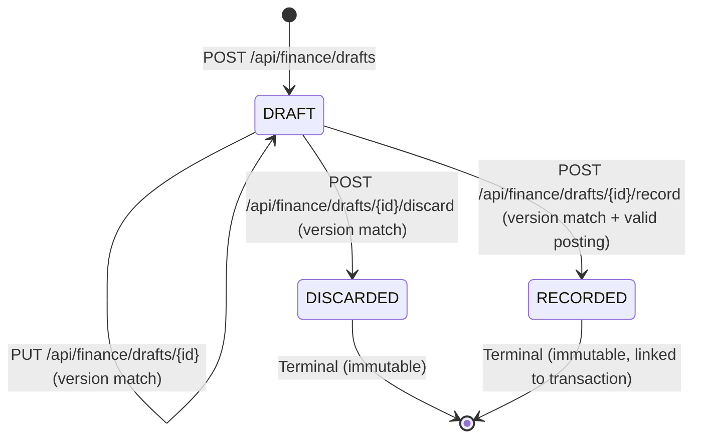

# Persistent Record Drafts & Safe Draft-to-Transaction Recording

**Feature:** `A-RECORDS-02` (Persistent Drafts & Safe Recording)
**Date:** 15 October 2026 (Asia/Karachi)
**Author:** Antigravity (Developer A Backend Coordinator)
**Target Assistant:** Codex (Developer A Frontend)
**Status:** **CONTRACT_READY** (Normative contract published; backend implementation in progress)
**Governing Contract:** `RECORD_DRAFTS.md` (Revision 1.0)
**Allocated Migration:** `V21__create_record_drafts.sql`

---

## 1. Feature Purpose & Boundaries

### 1.1 Objective
Allow users in the central Records workspace to:
1. **Save incomplete financial entries** without premature validation or data loss.
2. **Find and resume drafts** across browser sessions and devices.
3. **Update or discard drafts** with optimistic concurrency protection.
4. **Record drafts exactly once** into canonical financial transactions when complete.

### 1.2 Isolation & Non-Interference Invariants
* **Zero Financial Effects:** Drafts have strictly no effect on account balances, transaction summaries, monthly records, health scores, insights, or recommendations.
* **Bounded Transaction Scope:** Supports current PKR transaction types: `DIRECT_SALE_RECEIPT` and `OPERATING_EXPENSE_PAYMENT`. Undecided event types can remain `null`.
* **Exclusions:** No unclassified posted movements, OCR linkages, attachments, AI classification, transfers, or monthly ledger cutovers in this batch.
* **Server-Authoritative Context:** Drafts belong strictly to the server-resolved active business (`ActiveBusinessContext`). Supplying foreign references returns non-disclosing 404s.

---

## 2. Normative Wire Contract (CONTRACT_READY)

### 2.1 Permission Matrix
Reuses established financial transaction permissions:
| Operation | Required Permission | Allowed Roles | Denied Roles |
| :--- | :--- | :--- | :--- |
| **List Drafts** (`GET /api/finance/drafts`) | `FINANCIAL_TRANSACTION_READ` | `OWNER`, `ACCOUNTANT`, `MANAGER`, `VIEWER` | Denied (403) |
| **Read Draft** (`GET /api/finance/drafts/{id}`) | `FINANCIAL_TRANSACTION_READ` | `OWNER`, `ACCOUNTANT`, `MANAGER`, `VIEWER` | Denied (403) |
| **Create Draft** (`POST /api/finance/drafts`) | `FINANCIAL_TRANSACTION_POST` | `OWNER`, `ACCOUNTANT` | `MANAGER`, `VIEWER` (403) |
| **Update Draft** (`PUT /api/finance/drafts/{id}`) | `FINANCIAL_TRANSACTION_POST` | `OWNER`, `ACCOUNTANT` | `MANAGER`, `VIEWER` (403) |
| **Discard Draft** (`POST /api/finance/drafts/{id}/discard`) | `FINANCIAL_TRANSACTION_POST` | `OWNER`, `ACCOUNTANT` | `MANAGER`, `VIEWER` (403) |
| **Record Draft** (`POST /api/finance/drafts/{id}/record`) | `FINANCIAL_TRANSACTION_POST` | `OWNER`, `ACCOUNTANT` | `MANAGER`, `VIEWER` (403) |

Active business membership and permissions are rechecked on every request, including retries.

---

### 2.2 Lifecycle & Version Semantics


1. **States:**
   - `DRAFT`: In-progress entry. Can be edited, discarded, or recorded.
   - `RECORDED`: Successfully posted as a financial transaction. Immutable. Retains `recordedTransactionId`. Cannot be edited or recorded again.
   - `DISCARDED`: Abandoned draft. Immutable. Preserved for audit history. Cannot be edited or recorded.
2. **Optimistic Concurrency:**
   - Every draft maintains an integer/long `version` (starts at `0`, increments on every update, discard, or recording).
   - `PUT`, `discard`, and `record` operations require the current expected `version`. If the client supplies an outdated version, the server returns HTTP `409 Conflict`.
3. **Ready to Record Evaluation:**
   - The response field `readyToRecord` (boolean) is derived dynamically:
     - `accountId` is non-null and valid.
     - `eventType` is non-null (`DIRECT_SALE_RECEIPT` or `OPERATING_EXPENSE_PAYMENT`).
     - `effectiveDate` is non-null and within allowed posting bounds (`effectiveDate <= today(Karachi)` and `effectiveDate >= account.openingDate`).
     - `amountInput` is non-null and represents a valid positive monetary format.
   - `readyToRecord` is strictly an advisory indicator for the UI; recording atomically re-validates all posting rules.

---

### 2.3 Amount Semantics: Incomplete Text vs. Confirmed Amount
* **`amountInput` (Draft Input):**
  - Stored verbatim as bounded text (up to 100 characters).
  - May contain unfinished numbers (e.g. `"1500"`, `"1500."`), natural language fractions, Western group separators, or Arabic/Urdu digits.
  - Never treated as money; never silently defaulted to zero or today.
* **`confirmedAmount` (Recording Input):**
  - The client provides the user-confirmed canonical amount string when recording: `^(?:0|[1-9]\d*)\.\d{2}$`.
  - Must be strictly positive ($> 0.00$) and within capacity ($< 10^{12}$).
  - This is the exact amount posted to the transaction ledger.

---

### 2.4 Endpoints Specification

#### 1. Create Draft: `POST /api/finance/drafts`
* **Headers:** `Content-Type: application/json`, `X-XSRF-TOKEN`, `Idempotency-Key` (optional, 1..100 chars).
* **Request Body:**
```json
{
  "accountId": "a3b4c5d6-e7f8-4901-abcd-ef0123456789",
  "eventType": "DIRECT_SALE_RECEIPT",
  "effectiveDate": "2026-10-15",
  "amountInput": "1500.5",
  "description": "Partial payment from client"
}
```
*All fields in creation are optional.*
* **Response:** `201 Created` returning `DraftDetailResponse`.

#### 2. List Drafts: `GET /api/finance/drafts`
* **Query Parameters:**
  - `status` (optional, string): Filter by status: `DRAFT`, `RECORDED`, `DISCARDED`, or `ALL`. Default is `DRAFT`.
  - `accountId` (optional, UUID): Filter by account ID.
  - `eventType` (optional, string): Filter by event type.
  - `page` (optional, integer $\ge 0$, default 0).
  - `size` (optional, integer 1..100, default 20).
* **Ordering:** Deterministic `updatedAt DESC, createdAt DESC, id DESC`.
* **Response:** `200 OK` returning `DraftListResponse`.

#### 3. Read Draft: `GET /api/finance/drafts/{id}`
* **Path Parameter:** `id` (UUID).
* **Response:** `200 OK` returning `DraftDetailResponse` (or 404 if not found / outside business).

#### 4. Update Draft: `PUT /api/finance/drafts/{id}`
* **Path Parameter:** `id` (UUID).
* **Headers:** `Content-Type: application/json`, `X-XSRF-TOKEN`.
* **Request Body:**
```json
{
  "version": 0,
  "accountId": "a3b4c5d6-e7f8-4901-abcd-ef0123456789",
  "eventType": "DIRECT_SALE_RECEIPT",
  "effectiveDate": "2026-10-15",
  "amountInput": "1500.56",
  "description": "Updated payment description"
}
```
*`version` is required.*
* **Response:** `200 OK` returning `DraftDetailResponse`.
* **Errors:**
  - `409 Conflict`: If `version` does not match persisted draft version.
  - `409 Conflict`: If draft status is not `DRAFT` (already `RECORDED` or `DISCARDED`).

#### 5. Discard Draft: `POST /api/finance/drafts/{id}/discard`
* **Path Parameter:** `id` (UUID).
* **Headers:** `Content-Type: application/json`, `X-XSRF-TOKEN`.
* **Request Body:**
```json
{
  "version": 1,
  "reason": "Customer cancelled order"
}
```
*`version` is required; `reason` is optional (max 255 chars).*
* **Response:** `200 OK` returning `DraftDetailResponse` with `status: "DISCARDED"`.
* **Errors:** `409 Conflict` on version mismatch or if already recorded/discarded.

#### 6. Record Draft: `POST /api/finance/drafts/{id}/record`
* **Path Parameter:** `id` (UUID).
* **Headers:**
  - `Idempotency-Key` (required string, 1..100 chars).
  - `X-XSRF-TOKEN` (required).
  - `Content-Type: application/json`.
* **Request Body:**
```json
{
  "version": 1,
  "confirmedAmount": "1500.56",
  "accountId": "a3b4c5d6-e7f8-4901-abcd-ef0123456789",
  "eventType": "DIRECT_SALE_RECEIPT",
  "effectiveDate": "2026-10-15",
  "description": "Confirmed direct sale"
}
```
*`version` and `confirmedAmount` are required. `accountId`, `eventType`, `effectiveDate`, and `description` are optional confirmations or overrides for missing draft fields.*
* **Response:** `201 Created` returning `DraftRecordResponse`.
* **Atomic Posting & Rollback Invariants:**
  1. The draft is locked pessimistically (`findForUpdateByIdAndBusinessId`).
  2. If draft is already `RECORDED`:
     - If the request supplies the same `Idempotency-Key` and matching payload hash, returns the cached successful response (200/201).
     - If same key with differing payload: returns `409 Conflict`.
     - If different key: returns `409 Conflict` ("Draft has already been recorded").
  3. If draft is `DISCARDED`: returns `409 Conflict`.
  4. If version does not match: returns `409 Conflict`.
  5. The service delegates to `TransactionPostService.postTransaction(context, idempotencyKey, postRequest)`.
  6. If posting fails (e.g. cash deficit, invalid date, account inactive), the transaction rolls back completely: the draft remains in `DRAFT` status and no transaction is created.
  7. On success, the draft is marked `RECORDED` with `recordedTransactionId` set to the newly created transaction ID.

---

### 2.5 DTO Schemas

#### `DraftDetailResponse`
```json
{
  "id": "c1d2e3f4-a5b6-4789-0123-456789abcdef",
  "accountId": "a3b4c5d6-e7f8-4901-abcd-ef0123456789",
  "eventType": "DIRECT_SALE_RECEIPT",
  "effectiveDate": "2026-10-15",
  "amountInput": "1500.5",
  "description": "Partial payment from client",
  "status": "DRAFT",
  "readyToRecord": false,
  "version": 0,
  "recordedTransactionId": null,
  "createdById": "u1a2b3c4-d5e6-4789-abcd-ef0123456789",
  "updatedById": "u1a2b3c4-d5e6-4789-abcd-ef0123456789",
  "createdAt": "2026-10-15T08:30:00Z",
  "updatedAt": "2026-10-15T08:30:00Z"
}
```

#### `DraftRecordResponse`
```json
{
  "draft": {
    "id": "c1d2e3f4-a5b6-4789-0123-456789abcdef",
    "accountId": "a3b4c5d6-e7f8-4901-abcd-ef0123456789",
    "eventType": "DIRECT_SALE_RECEIPT",
    "effectiveDate": "2026-10-15",
    "amountInput": "1500.56",
    "description": "Confirmed direct sale",
    "status": "RECORDED",
    "readyToRecord": true,
    "version": 1,
    "recordedTransactionId": "t1a2b3c4-d5e6-4789-abcd-ef0123456789",
    "createdById": "u1a2b3c4-d5e6-4789-abcd-ef0123456789",
    "updatedById": "u1a2b3c4-d5e6-4789-abcd-ef0123456789",
    "createdAt": "2026-10-15T08:30:00Z",
    "updatedAt": "2026-10-15T08:35:00Z"
  },
  "transaction": {
    "id": "t1a2b3c4-d5e6-4789-abcd-ef0123456789",
    "businessId": "b1a2b3c4-d5e6-4789-abcd-ef0123456789",
    "accountId": "a3b4c5d6-e7f8-4901-abcd-ef0123456789",
    "eventType": "DIRECT_SALE_RECEIPT",
    "amount": "1500.56",
    "currency": "PKR",
    "effectiveDate": "2026-10-15",
    "description": "Confirmed direct sale",
    "actorUserId": "u1a2b3c4-d5e6-4789-abcd-ef0123456789",
    "resultingBalance": "101500.56",
    "createdAt": "2026-10-15T08:35:00Z",
    "movements": [
      {
        "id": "m1a2b3c4-d5e6-4789-abcd-ef0123456789",
        "accountId": "a3b4c5d6-e7f8-4901-abcd-ef0123456789",
        "direction": "INCREASE",
        "amount": "1500.56",
        "currency": "PKR",
        "effectiveDate": "2026-10-15"
      }
    ]
  }
}
```

#### Standard Error Response Examples (apiClient Compatible)
**Validation Failure (`400 Bad Request`):**
```json
{
  "status": 400,
  "error": "Validation Failed",
  "message": "One or more request parameters are invalid",
  "errors": {
    "amountInput": "Amount input must not exceed 100 characters",
    "eventType": "Invalid eventType: UNKNOWN. Supported types: DIRECT_SALE_RECEIPT, OPERATING_EXPENSE_PAYMENT"
  }
}
```

**Optimistic Concurrency Conflict (`409 Conflict`):**
```json
{
  "status": 409,
  "error": "Conflict",
  "message": "Draft has been modified by another request; expected version 0 but found 1"
}
```

**Resource Not Found (`404 Not Found`):**
```json
{
  "status": 404,
  "error": "Not Found",
  "message": "Record draft not found"
}
```

---

## 3. Database Migration Design: `V21__create_record_drafts.sql`

```sql
CREATE TABLE IF NOT EXISTS record_drafts (
    id UUID PRIMARY KEY DEFAULT gen_random_uuid(),
    business_id UUID NOT NULL REFERENCES businesses(id) ON DELETE CASCADE,
    account_id UUID REFERENCES financial_accounts(id) ON DELETE SET NULL,
    event_type VARCHAR(50),
    effective_date DATE,
    amount_input VARCHAR(100),
    description VARCHAR(255),
    status VARCHAR(20) NOT NULL DEFAULT 'DRAFT',
    version BIGINT NOT NULL DEFAULT 0,
    recorded_transaction_id UUID REFERENCES financial_transactions(id) ON DELETE SET NULL,
    created_by_id UUID NOT NULL REFERENCES app_users(id) ON DELETE RESTRICT,
    updated_by_id UUID NOT NULL REFERENCES app_users(id) ON DELETE RESTRICT,
    created_at TIMESTAMP WITH TIME ZONE NOT NULL DEFAULT CURRENT_TIMESTAMP,
    updated_at TIMESTAMP WITH TIME ZONE NOT NULL DEFAULT CURRENT_TIMESTAMP,

    CONSTRAINT chk_record_draft_status CHECK (status IN ('DRAFT', 'RECORDED', 'DISCARDED')),
    CONSTRAINT chk_record_draft_event_type CHECK (event_type IS NULL OR event_type IN ('DIRECT_SALE_RECEIPT', 'OPERATING_EXPENSE_PAYMENT')),
    CONSTRAINT chk_record_draft_recorded_tx CHECK (
        (status = 'RECORDED' AND recorded_transaction_id IS NOT NULL) OR
        (status != 'RECORDED' AND recorded_transaction_id IS NULL)
    )
);

CREATE INDEX IF NOT EXISTS idx_record_drafts_business_status
    ON record_drafts (business_id, status, updated_at DESC);

CREATE INDEX IF NOT EXISTS idx_record_drafts_account
    ON record_drafts (account_id) WHERE account_id IS NOT NULL;

CREATE INDEX IF NOT EXISTS idx_record_drafts_recorded_tx
    ON record_drafts (recorded_transaction_id) WHERE recorded_transaction_id IS NOT NULL;

GRANT SELECT, INSERT, UPDATE, DELETE ON record_drafts TO finsight_app;
```

---

## 4. Implementation Deliverables & Architecture

### 4.1 Backend Components Authored
Dedicated feature package: `com.app.sme_health_backend.accounting.draft`
* **Entity & Status:**
  * `RecordDraft.java`: JPA entity with optimistic locking (`@Version private Long version`), raw text `amountInput`, audit actor timestamps.
  * `DraftStatus.java`: `DRAFT`, `RECORDED`, `DISCARDED`.
* **Repository:**
  * `RecordDraftRepository.java`: Spring Data JPA repository with `findByIdAndBusinessId`, `JpaSpecificationExecutor` for dynamic filtering, and `@Lock(LockModeType.PESSIMISTIC_WRITE)` query `findForUpdateByIdAndBusinessId` for race-free atomic recording.
* **Service:**
  * `RecordDraftService.java`: Business logic implementing draft lifecycle:
    * Incomplete drafts stored safely without financial side-effects.
    * Create idempotency backed by `financial_idempotency_records` (`operation = "RECORD_DRAFT_CREATE"`).
    * Optimistic version verification on update and discard (`DraftConflictException` with HTTP 409).
    * Pessimistic row locking on draft record to guarantee exactly-once posting under concurrent requests.
    * Atomic recording via canonical `TransactionPostService.postTransaction`, linking `recordedTransactionId` upon success, and rolling back fully if posting fails.
    * Safe recovery on repeat recording requests with identical `Idempotency-Key`.
    * Computation of `readyToRecord` flag based on field presence and valid PKR amount pattern.
* **REST Controller:**
  * `RecordDraftController.java`: Endpoints mapped under `/api/finance/drafts`:
    * `POST /api/finance/drafts` (201 Created)
    * `GET /api/finance/drafts` (200 OK, paginated/filtered)
    * `GET /api/finance/drafts/{id}` (200 OK)
    * `PUT /api/finance/drafts/{id}` (200 OK)
    * `POST /api/finance/drafts/{id}/discard` (200 OK)
    * `POST /api/finance/drafts/{id}/record` (201 Created)
* **DTOs:**
  * `DraftCreateRequest.java`, `DraftUpdateRequest.java`, `DraftDiscardRequest.java`, `DraftRecordRequest.java`
  * `DraftDetailResponse.java`, `DraftSummaryItem.java`, `DraftListResponse.java`, `DraftRecordResponse.java`
* **Exceptions:**
  * `DraftValidationException.java` (mapped to HTTP 400 Bad Request with field-level errors)
  * `DraftConflictException.java` (mapped to HTTP 409 Conflict)

### 4.2 Shared File Reservations
Minimal touchpoint:
* `backend/src/main/java/com/app/sme_health_backend/shared/exception/GlobalExceptionHandler.java`:
  * Added `@ExceptionHandler(DraftValidationException.class)` returning 400 Bad Request with `{"message": "Validation failed", "errors": {...}}`.
  * Added `@ExceptionHandler(DraftConflictException.class)` returning 409 Conflict with `{"message": ex.getMessage(), "status": 409}`.

### 4.3 Database Migration Reserved & Executed
* File: `backend/src/main/resources/db/migration/V21__create_record_drafts.sql`
* Executed and verified cleanly against real embedded PostgreSQL with `finsight_migrator` and restricted `finsight_app` DML runtime permissions.

---

## 5. Verification & Test Evidence

### 5.1 Unit & Integration Test Suites
All test suites executed fresh locally against Java 21 and embedded PostgreSQL 14.22:

| Test Suite | Class | Tests Run | Result | Key Capabilities Verified |
| :--- | :--- | :--- | :--- | :--- |
| **Draft Service Unit** | `RecordDraftServiceTest` | 15 | **PASSED** (0 failures, 0 errors) | Incomplete creation, raw text preservation, invalid account rejection, length bounds, create replay, optimistic versioning, discard, atomic recording, missing field rejection, failed posting draft preservation, concurrent recording conflict, safe recovery |
| **Draft Controller WebMvc** | `RecordDraftControllerTest` | 13 | **PASSED** (0 failures, 0 errors) | RBAC matrix (`OWNER`/`ACCOUNTANT` allowed mutation, `MANAGER`/`VIEWER` read-only/denied 403), status codes (201/200/400/404/409), Idempotency-Key validation |
| **PostgreSQL Integration** | `RecordDraftPostgreSqlIT` | 8 | **PASSED** (0 failures, 0 errors) | Real PostgreSQL persistence, V21 Flyway migration, zero financial side-effects, cross-business tenant isolation, optimistic version conflict, create idempotency replay, atomic posting + movement creation, failed posting rollback, concurrent 6-thread race (1 winner, 5 conflicts), repeat recording recovery |
| **Draft Feature Total** | — | **36** | **ALL PASSED** | Complete feature coverage |

### 5.2 Accounting Regression Suite
Full accounting regression suite executed locally:
* `TransactionControllerTest`: 11 passed
* `TransactionPostServiceTest`: 13 passed
* `FinancialTransactionPostgreSqlIT`: 11 passed
* `FinancialAccountPostgreSqlIT`: 18 passed
* `AccountControllerTest`: 15 passed
* `AccountCreateServiceTest`: 14 passed
* `AccountReadServiceTest`: 16 passed
* `CurrencyRegistryTest`: 35 passed
* `ProjectFundingGapCalculatorTest`: 24 passed
* **Total Accounting Tests:** **157 passed** (0 failures, 0 errors).

### 5.3 Financial Model & Scoring Fingerprint Invariance
Executed historical monthly record, scoring, and advice tests:
* `MonthlyRecordServiceTests`
* `MonthlyRecordIntegrationTests`
* `ScoringServiceTests`
* `ScoreControllerTests`
* `AdviceContextServiceTests`
* **Total Fingerprint Invariance Tests:** **44 passed** (0 failures, 0 errors).
* **Fingerprint Invariants:** Zero changes to `monthly_records`, `score_results`, `insights`, or `recommendations`.

---

## 6. Runtime Readiness & Remaining Limitations
1. **Runtime Verification:** Running review services on ports 8180 (backend) and 3180 (frontend) were preserved untouched throughout test execution.
2. **Frontend Coordination:** The wire contract is fully stable and marked `CONTRACT_READY`. Codex has commenced consumption in parallel.
3. **Scope Boundaries:** Unclassified posted cash movements, OCR review linkage, attachments, AI classification, transfers, and monthly cutover are explicitly deferred to subsequent Phase 2 batches.


---

## 7. Frontend and Real Integration Evidence — A-RECORDS-02-FE (Codex, 15 October 2026)

**Status: FRONTEND_VERIFIED_BY_ISOLATED_CHECKS; LIVE_ACCEPTANCE_BLOCKED. Not INTEGRATION_VERIFIED.** Antigravity was reported PAUSED and its documentation editing window released by the project lead before this append. Normative/backend sections above were preserved.

### 7.1 Checkout and consumed interface

- Branch `dev/suleman`; actual HEAD `e586b0651c2ac77100eb48c4684e6686280ba483` (differs from the originally supplied `e586b06385a538258e72fb4d385f0ef3a921d723`). No branch switching or Git mutations.
- Consumed revision 1.0 CONTRACT_READY and its implementation evidence, cross-checked against the published Java DTO/controller/service files in `accounting/draft/`.
- Actual `DraftListResponse` uses `items`, `page`, `size`, `totalElements`, `totalPages`. Actual `DraftRecordResponse.transaction` embeds the existing `TransactionDetailResponse`, so the frontend reuses its strict parser (including `createdByUserId`, `movementDirection`, account metadata, base amount and matching movement). These source-backed details should be added/corrected in section 2.5; its illustrative transaction JSON currently differs. Actual update is full replacement: null/omitted values clear nullable fields. The UI sends the full allowlisted editing payload.
- `readyToRecord` is treated as advisory only. The frontend saves changes first, then requires review/confirmation of the acknowledged saved version and its normalized positive amount. Recording sends only `{version, confirmedAmount}` to the dedicated draft-record operation; it never falls back to ordinary transaction POST or silently posts unsaved account/type/date changes.

### 7.2 Exact frontend paths authored/changed in this task

New:
- `frontend/src/components/records/DraftEntryFields.tsx`
- `frontend/src/components/records/DraftsWorkspace.tsx`
- `frontend/src/components/records/draft-copy.ts`
- `frontend/src/components/records/draft-entry.ts`
- `frontend/src/components/records/draft-recording.ts`
- `frontend/src/lib/api/dev-a/drafts.ts`
- `frontend/tests/record-drafts.test.mjs`
- `frontend/tests/record-drafts.live.mjs`

Changed:
- `frontend/src/app/records/page.tsx`
- `frontend/src/components/finance/transactions/PostTransactionForm.tsx`
- `frontend/src/components/finance/transactions/TransactionsList.tsx`
- `frontend/tests/transactions.test.mjs`
- `frontend/tests/accounts-live.integration.mjs`
- This append to `docs/phase2/RECORD_DRAFTS.md` only.

No backend, migration, shared implementation-state, shared authentication/transport/navigation, dependency, manifest, lockfile or environment-file edits by Codex. Existing concurrent backend changes, tests, V21 and `backend/.cp.txt` were preserved.

### 7.3 Implemented behavior

Records now includes To review, explicit Save draft alongside direct recording, and unfinished entry creation with undecided/missing fields. Saved entries show description, raw amount text, missing-information labels, update time, lifecycle status and pagination/status filters. Editors support acknowledged save, dirty-close save/discard-edits/continue choices, deliberate saved-draft discard, version-conflict comparison/reload, and recorded transaction detail links. Terminal drafts cannot be edited/recorded through the UI.

Raw input remains editing text. Existing exact-string PKR HALF_UP normalization supplies the visible recording preview. No browser financial totals or balances are calculated. Save responses that change raw amount text are rejected rather than silently replacing it. Local input validation failures remain editable. No autosave or localStorage content persistence was added.

Recording freezes operation identity/payload, prevents double submission, retries only explicitly after uncertainty, and becomes complete before any subsequent list/account refresh. A refresh failure is displayed separately by the resources; it does not re-enable recording or erase recorded success. Context-keyed private editors/resources plus existing transport cancellation reject late old-business/session responses. OWNER/ACCOUNTANT presentation reuses the existing role helper; server authorization remains authoritative. Demo never mounts private draft loaders or mutations.

### 7.4 Fresh checks and environment

Dependency auto-install disabled with process-only `pnpm_config_verify_deps_before_run=false`. Existing installed dependencies only.

| Check | Fresh result |
| --- | --- |
| `pnpm exec node --test tests/record-drafts.test.mjs tests/transactions.test.mjs` | Exit 0, 39 tests passed |
| `pnpm test` (final frontend gate) | Exit 0, 135 passed, zero failed/skipped |
| `pnpm exec tsc --noEmit --incremental false` | Exit 0 |
| `pnpm run lint` | Exit 0, only pre-existing SessionProvider.tsx:204 warning |
| `mvnw.cmd -DskipTests compile` | Exit 0, current classes up to date; no claim that backend tests were rerun |
| Live production `pnpm run build` | Exit 0; existing Next middleware deprecation warning |
| Combined `pnpm exec node tests/accounts-live.integration.mjs` | Exit 1, 41 passing check groups, exactly two backend blockers below |
| Demo production build and `... accounts-live.integration.mjs --demo` | Exit 0; EN/UR accounts/transactions/Records/To-review preview, zero private API requests |
| Restored live production build and `... accounts-live.integration.mjs --review` | Exit 0; actual normal-login EN/UR/mobile Records smoke passed |
| Final restored-app smoke after local-validation guard | Exit 0; normal login, incomplete saved sample, mobile Records, actual 20,000.00 received total and editable local input error; no smoke posting |

The combined run used actual Spring on localhost 8280, production Next on localhost 3180, Edge, and disposable PostgreSQL 14.22 migrated through V21, separate migrator/runtime roles, normal sessions, CSRF and server permissions. Source/class freshness is checked for draft service/controller/DTO and existing accounts/posting classes. Java reports its loaded draft service CodeSource and SHA-256; the harness compares it with current `target/classes`. Draft service hash: `1b575520404e05524d28e015bfba1e8089a36fd59da5ae54912f2f2e64cbceb5`. Stale running backend classes were excluded as the explanation.

The final combined run predates only the final preliminary local-input guard (which sends no HTTP request for invalid local fields). Full isolated tests, TypeScript/lint, production build and real review smoke were rerun after that guard. No claim that the final guard received a third full combined run.

### 7.5 Actual acceptance evidence

Real HTTP/database: incomplete create/read/update/discard; nullable full replacement; stale-version rejection; terminal discard rejection; OWNER/ACCOUNTANT writes and MANAGER/VIEWER read-only authorization; cross-business 404; six simultaneous different-key record requests produced one successful recording and five conflicts with one extra transaction; same-key identical recording recovery; failed posting preserved DRAFT and unchanged financial surface fingerprint. Create/update/discard did not affect account balances, transaction totals or summaries. Successful recording changed authorized transaction/accounting surfaces only.

Real browser: Save draft from Add record with `1500.` and missing account; reload/resume with exact unfinished text; a separately signed-in session resumed `42.`; failed save retained editing fields; stale-version conflict preserved unsaved description and deliberate comparison/replacement; unsaved edits blocked recording; saved raw `1500.555` visibly normalized to `1500.56`; lost real recording-response delivery recovered with identical key and identical `{version,confirmedAmount}`; discard confirmation reached an immutable terminal state; delayed real draft detail was discarded on cross-tab business switch; session removal cleared a private unfinished editor; MANAGER/VIEWER read-only presentation; Urdu/RTL/mobile and keyboard dirty-close choices.

Preserved account read/create/posting/history/detail, historical monthly-summary navigation, OCR return, natural entry, summary drill-down, CSRF/permissions/idempotency/concurrency, session/business-switch and outage checks passed. Original capacity rejection, malformed amount rejection and current-only overflow/nullability regressions remained closed. Independent Records summary remained `4501.06 / 0.00 / 4501.06`, count 3. Nonempty `monthly_records`, `score_results`, `insights` and `recommendations` row-count/content fingerprints stayed unchanged through the final mutations. Monthly cutover remains unimplemented. OCR/external providers were not started or newly verified.

### 7.6 Exact backend blockers for Antigravity

**BE-DRAFT-RAW — verbatim input loss (section 2.3).**

Actual synthetic request: `POST /api/finance/drafts`, body includes `{"amountInput":" ۱۵۰۰. "}`. Actual HTTP 201 response field: `"amountInput":"۱۵۰۰."`. Expected: preserve `" ۱۵۰۰. "` verbatim. Both create and update service paths call `.trim()` before storage/length checks. Preserve the original bounded amount-input text; ensure capacity is checked on original text, without bypassing the 100-character bound through trimming. No client-side workaround should silently replace the user's raw text. Frontend strict response-echo validation now retains local text on this violation.

**BE-DRAFT-REPLAY — same-key/different-payload accepted (section 2.4.6.2).**

Actual request sequence to the same synthetic draft `cec50105-0822-4feb-b825-6c7bc9aafc68`:
1. `POST /api/finance/drafts/{id}/record`, same operation key, body `{"version":0,"confirmedAmount":"15.55"}` -> HTTP 201 and a recorded transaction amount `15.55`.
2. Identical body/key -> HTTP 201 with the original transaction (valid recovery).
3. Same key, body `{"version":0,"confirmedAmount":"16.55"}` -> **HTTP 201**, `transaction.amount="15.55"`; expected **409 Conflict**.

The recorded-draft replay branch retrieves the underlying transaction idempotency result and compares only transaction identity with `recordedTransactionId`; it does not verify the incoming original recording payload hash. Add durable validation of recording operation identity and same-key payload equality, including the reviewed original version and confirmed amount, before returning a cached result. Preserve valid same-key/same-payload recovery and different-key terminal rejection. Frontend request freezing does not replace this server requirement.

Both violations remained visible harness blockers; no assertions or frontend validation were weakened to hide them. Normative sections and backend files were not edited by Codex. Remaining acceptance requires backend correction, current compilation and a fresh combined harness exit 0.

### 7.7 Review application left available

- URL: `http://127.0.0.1:3180/records`; To review: `/records?view=review`.
- Current V21 Spring: localhost 8280, PID 25028. Current Next: localhost 3180, PID 24628. Isolated PostgreSQL: loopback-only 63493, PID 17760; migration head V21.
- New independent review setup includes labelled sample accounts/transactions and an unfinished draft; no existing user database was seeded or migrated. Old review Spring 8180 and its V20 PostgreSQL/data were preserved, not stopped or migrated. Its former Next process alone was stopped for the exclusive build window.
- Private operational directory: `C:\Users\PC\Documents\Codex\2026-10-14\you-are-joining-finsight-as-the\work\finsight-review-v21`. `credentials.txt` stays private; no password/token/MFA secret is included here. `processes.json` identifies these task-owned services. `stop-review.ps1` verifies their command paths before stopping only the new Next/Java runtime; Java closes only its own isolated PostgreSQL. Old review services are excluded.
- Final HTTP GET `/records`: 200. Full F01 and production readiness are not claimed.


---

## 8. Backend Parity Resolution — A-RECORDS-02-BE-PARITY (Antigravity, 15 October 2026)

**Status: BACKEND_PARITY_READY. Paused for Codex targeted retest and combined harness (`accounts-live.integration.mjs`). Not INTEGRATION_VERIFIED. No Git mutations or migration rewrites.**

### 8.1 Defect Root Causes and Corrections

#### 1. FIX 1 (`BE-DRAFT-RAW`) — Verbatim Raw Amount Input Preservation
* **Root Cause:** Both `createDraft` (lines 131–133) and `updateDraft` (lines 345–347) in `RecordDraftService.java` applied `.trim()` to `request.amountInput()` prior to length bounds checking and model persistence. This stripped leading and trailing whitespace from raw entries such as `" ۱۵۰۰. "`, violating Section 2.3 of the wire contract.
* **Correction Applied:**
  - Removed trimming from `createDraft` and `updateDraft`. Raw input is stored verbatim into `RecordDraft.amountInput`.
  - Enforced length validation (`amountInput.length() > 100`) directly on the untrimmed string. This prevents capacity bypass through whitespace padding while preserving verbatim user input.
  - Canonical transaction posting-amount syntax and decimal rounding rules remain completely separate.

#### 2. FIX 2 (`BE-DRAFT-REPLAY`) — Recording Replay Payload Identity Enforcement
* **Root Cause:** In `RecordDraftService.recordDraft`, when a draft was already in `RECORDED` status, the recovery branch checked only whether the underlying cached transaction ID matched `draft.getRecordedTransactionId()`. It bypassed comparing the incoming request's payload hash against the stored `FinancialIdempotencyRecord.requestHash` and omitted checking the reviewed version against `draft.getVersion() - 1`. Consequently, a retry request using the same `Idempotency-Key` but a changed `confirmedAmount` (e.g. `15.55` changed to `16.55`) returned HTTP 201 with the cached original transaction instead of the documented HTTP 409 Conflict.
* **Correction Applied:**
  - When `draft.getStatus() == DraftStatus.RECORDED`:
    1. Evaluated `cachedTx.id().equals(draft.getRecordedTransactionId())` (mismatch throws `DuplicateResourceException` -> 409 Conflict).
    2. Evaluated `Objects.equals(request.version(), draft.getVersion() - 1)` (mismatch throws `DuplicateResourceException` -> 409 Conflict).
    3. Resolved effective values and computed the canonical transaction payload hash via `TransactionPostService.computePayloadHash(...)` across all operational fields: `effectiveAccountId`, `eventType`, `amount` (`new BigDecimal(trimmedAmount).setScale(2, RoundingMode.UNNECESSARY)`), `effectiveDate`, and `trimmedDescription`.
    4. Evaluated `existing.getRequestHash().equals(currentPayloadHash)`. If mismatched, throws `DuplicateResourceException("Idempotency key '" + trimmedKey + "' has already been used with a different request payload")` -> HTTP 409 Conflict.
    5. If all validations match, safely returns the cached `DraftRecordResponse`.
  - When `draft.getStatus() == DraftStatus.DRAFT`: added ordinary idempotency protection ensuring an unrecorded draft cannot claim or reuse an existing idempotency key from a prior transaction (throws `DuplicateResourceException` -> 409 Conflict).
  - Ensured replay and conflict paths create no additional transactions, movements, or balance changes.

### 8.2 Changed Backend Paths

* `backend/src/main/java/com/app/sme_health_backend/accounting/draft/RecordDraftService.java`
  - Verbatim raw amount input preservation in `createDraft` and `updateDraft`.
  - Full request-identity replay hash and version comparison in `recordDraft`.
  - Ordinary idempotency guard on unrecorded drafts.
* `backend/src/test/java/com/app/sme_health_backend/accounting/draft/RecordDraftServiceTest.java`
  - Added `draftPreservesVerbatimAmountInput` verifying create and update with whitespace, Eastern Arabic/Urdu digits, and unfinished punctuation.
  - Added `createDraftRejectsExcessiveAmountLength` verifying whitespace padding cannot bypass the 100-character capacity limit.
  - Added `replayChangedConfirmedAmountThrowsConflict` verifying same-key changed amount returns 409.
  - Added `replayChangedVersionThrowsConflict` verifying same-key changed version returns 409.
  - Added `replayChangedDescriptionThrowsConflict` verifying same-key changed description returns 409.
  - Added `unrecordedDraftReusingKeyThrowsConflict` verifying unrecorded drafts cannot reuse existing keys.
* `backend/src/test/java/com/app/sme_health_backend/accounting/draft/RecordDraftControllerTest.java`
  - Added `recordDraft_duplicateResourcePayloadMismatch` verifying controller returns HTTP 409 on duplicate key payload mismatch.
* `backend/src/test/java/com/app/sme_health_backend/accounting/draft/RecordDraftPostgreSqlIT.java`
  - Added `IT-DRAFT-09` reproducing the exact live failure sequence (`record` with 15.55 -> repeat 15.55 returns 201 -> same key with 16.55 returns 409 Conflict -> distinct key returns 409 Conflict -> verified database integrity: exactly 1 transaction, 1 movement, balance increased by exactly 15.55).
  - Added `IT-DRAFT-10` testing round-trip create, read, and update preserving verbatim raw amount input with whitespace and Urdu digits, direct database raw column verification, and raw 100-character capacity enforcement.

### 8.3 Verification Evidence

| Test Suite / Command | Scope | Fresh Execution Result |
| :--- | :--- | :--- |
| `.\mvnw.cmd test -Dtest=RecordDraftServiceTest,RecordDraftControllerTest,TransactionPostServiceTest` | Unit / Controller / Posting | **Exit 0, 47 tests passed (0 failures, 0 errors)** |
| `.\mvnw.cmd test -Dtest=RecordDraftPostgreSqlIT` | Real PostgreSQL 14.22 Disposable Integration | **Exit 0, 10 integration tests passed (0 failures, 0 errors)** |
| `.\mvnw.cmd compile` | Backend Compilation | **Exit 0, classes up to date in `target/classes`** |
| `RecordDraftService.class` SHA-256 | CodeSource Verification | `0e7ed63cc9cffdaf510641323f2b12b72f6178a15ff38be9cda60df35fb3798b` |

### 8.4 Review Environment Coordination

* Review processes verified running:
  - Spring Boot: localhost 8280 (PID 25028)
  - Next.js: localhost 3180 (PID 24628)
  - Disposable PostgreSQL V21: port 63493 (PID 17760)
* Preserved all review services untouched with existing review data intact.
* All updated Java classes have been compiled to `backend/target/classes`.
* Untracked `backend/.cp.txt`, frontend changes, and migrations V1–V21 preserved untouched.

**PAUSED for Codex targeted retest and combined live harness.**


---

## 9. Frontend Backend-Parity Retest (Codex, 15 October 2026)

**Status: ORIGINAL TWO DEFECTS CLOSED; LIVE ACCEPTANCE BLOCKED by BE-DRAFT-REPLAY-SYNTAX. Not INTEGRATION_VERIFIED. PAUSED.** Section 8 was read as reported backend evidence; its 47 unit/controller/posting and 10 PostgreSQL tests were not represented as rerun by Codex. Normative/backend sections were preserved.

### 9.1 Current code and preservation

- Branch remains `dev/suleman`, HEAD `e586b0651c2ac77100eb48c4684e6686280ba483`.
- Existing review JVM on 8280 still contains the earlier loaded draft service hash `1b575520404e05524d28e015bfba1e8089a36fd59da5ae54912f2f2e64cbceb5`. Updating files in `target/classes` does not replace classes already loaded by this JVM. It and its database were left untouched to preserve review data.
- Fresh acceptance and corrected-code review JVMs load `RecordDraftService` from the existing checkout's `backend/target/classes/`, SHA-256 `0e7ed63cc9cffdaf510641323f2b12b72f6178a15ff38be9cda60df35fb3798b`, matching Section 8/current compiled bytes. The harness checks source/class timestamps and compares Java's actual loaded CodeSource/hash with current target classes. This is fresh-runtime evidence, not an assumption based on the on-disk class alone.
- Parallel reserved ports avoid stopping/migrating any previous review database: transparent localhost gateway 3280, real production Next 3281, real Spring 8380, disposable PostgreSQL 14.22 migrated through V21. The gateway forwards `/api/` unchanged to Spring and page/assets to Next. No API fixtures, mock fallback, security bypass, shared transport/auth changes or environment-file changes. Normal cookies, X-XSRF-TOKEN, server permissions and business/session handling remain exercised. Next middleware already excludes API paths; page security headers still come from real production Next.
- Unchanged production live frontend build was reused. No source UI changes, dependency changes, backend/migration changes or Git mutations by Codex in this retest. Existing backend work and `.cp.txt` preserved.

### 9.2 Retest results

Fresh real HTTP/browser combined command (dependency auto-install disabled; existing Playwright/Edge): `pnpm exec node tests/accounts-live.integration.mjs`.

**Exit 1: 44 passing groups, one remaining backend blocker.** `test-artifacts/accounts-live/results.json` reports `PostgreSQL 14.22;schema=21`, corrected loaded class hash, and `integrated=false`. Detailed synthetic request/response diagnostics are in ignored `test-artifacts/accounts-live/draft-parity.json`; no credential, CSRF token or idempotency-key value is recorded there.

Verified fresh:
1. Create/read/update preserve raw amount input verbatim: surrounding whitespace, tabs/newlines, Urdu and Arabic digits and unfinished punctuation. A 100-character raw value is accepted; 101 characters (including whitespace padding) return 400 for create and update. Rejected update preserves prior version/raw value. **BE-DRAFT-RAW closed.**
2. Identical same-key recording retry returns the original transaction. Same key with changed confirmed amount, reviewed version, description, event, effective date or account returns 409. A different key cannot re-record a recorded draft. No additional transaction/movement/idempotency/audit writes or account/summary changes occur on these replay/conflict paths. **BE-DRAFT-REPLAY original changed-payload defect closed.**
3. An unrecorded draft cannot claim another draft's recorded operation key or an ordinary transaction operation's key; both return 409, remain DRAFT, and do not add financial writes.
4. Malformed replay forms `15.550`, `1.555e1`, `+15.55`, `015.55`, `15.5`, `15`, `15,55`, `NaN`, `Infinity`, Urdu/Arabic canonical-amount digits return 400. Zero, capacity overflow and a 1000-digit amount return controlled 400/409 responses. No tested replay case returned 500. `BigDecimal/setScale` does not bypass the preceding regex for these forms; the remaining weakness is trimming before applying that regex.
5. All previous draft create/edit/discard/record, concurrent different-key exactly-once recording, failed-post rollback, lost-response recovery, cross-session persistence, stale-version comparison, tenant/session cancellation, read-only roles, EN/UR/RTL/mobile/keyboard journeys passed.
6. Account read/create, original capacity/nullability/malformed posting regressions, transaction history/detail, Records/historical summaries, period totals and drill-downs passed. Independent summary stayed `4501.06 / 0.00 / 4501.06`, count 3. Draft editing/discard/rejected posting had no financial effects. Monthly/score/insight/recommendation row/content fingerprints remained unchanged through the run, including successful draft recording. Monthly cutover remains unimplemented.

Only these frontend test files changed in this retest:
- `frontend/tests/accounts-live.integration.mjs` (parallel real runtime/gateway and actual loaded draft-class evidence).
- `frontend/tests/record-drafts.live.mjs` (expanded parity, bounds, operation identity and malformed recovery tests/diagnostics).

`node --check` on both edited harness files: exit 0. `pnpm exec eslint tests/accounts-live.integration.mjs tests/record-drafts.live.mjs`: exit 0. Unchanged 135-test frontend suite, TypeScript, production build and zero-private-request demo evidence from Section 7 were reused; they were not claimed as fresh reruns here.

### 9.3 Remaining precise backend defect for Antigravity

**BE-DRAFT-REPLAY-SYNTAX — malformed wrappers accepted after trimming.**

Synthetic draft `fd0e9134-a96e-4699-8d60-30324a47a577` was successfully recorded with body `{"version":0,"confirmedAmount":"15.55"}`. The original operation key was reused for the following requests to `POST /api/finance/drafts/fd0e9134-a96e-4699-8d60-30324a47a577/record`:

| Exact JSON confirmedAmount | Actual response | Expected |
| --- | --- | --- |
| `" 15.55 "` | 201; cached transaction amount `15.55` | 400 canonical syntax rejection |
| `"\t15.55\t"` | 201; cached transaction amount `15.55` | 400 canonical syntax rejection |
| `"15.55\n"` | 201; cached transaction amount `15.55` | 400 canonical syntax rejection |
| `"\u000015.55\u0000"` | 201; cached transaction amount `15.55` | 400 canonical syntax rejection |

All requests use version 0 and return the original transaction `67393b6c-8de2-41b2-94e7-7d4d848ce298`, with no extra financial writes. The issue is lexical acceptance, not duplicate posting or a 500.

Cause: `recordDraft` assigns `trimmedAmount = request.confirmedAmount().trim()` before `EXACT_TWO_DECIMAL_AMOUNT.matcher(trimmedAmount).matches()`. Java `trim()` also removes the tested NUL wrappers. Recovery then converts the already-cleaned text through BigDecimal/setScale and successfully matches the original canonical payload hash.

Minimal requested correction: enforce the normative canonical confirmed-amount syntax on the original wire string before trimming/parsing or replay recovery. Reject surrounding whitespace/control characters rather than repairing them. Keep exact raw draft `amountInput` preservation separate. Retain same-key/same-payload recovery, changed-payload/version conflicts, capacity safeguards and controlled errors; add replay regressions for these four exact inputs. Do not alter the correct frontend validator to accept them. Backend ownership preserved; no backend fix was made by Codex.

### 9.4 Available review applications

- Corrected-class review: `http://127.0.0.1:3280/records` and `/records?view=review`. Actual normal-login EN/UR/mobile smoke (`accounts-live.integration.mjs --review`) exited 0; final HTTP GET `/records` returned 200. Setup adds only clearly labelled synthetic samples in its new isolated database.
- Gateway: 3280 PID 25552. Production Next: 3281 PID 27304. Spring: 8380 PID 26064. Loopback-only PostgreSQL V21: 57870 PID 8252. Loaded draft hash matches the corrected Section 8 hash above.
- Private operational directory: `C:\Users\PC\Documents\Codex\2026-10-14\you-are-joining-finsight-as-the\work\finsight-review-v21-parity`; private `credentials.txt`, `processes.json` and path-verifying `stop-review.ps1`. Stop script stops only this gateway/Next/Java runtime; Java closes only its own PostgreSQL.
- Original review `http://127.0.0.1:3180/records` (Next 24628 / older Spring 8280 PID 25028 / PostgreSQL 63493) remains running, HTTP 200, with its data intact. Earlier V20 review services also remain untouched. The original 8280 JVM is explicitly not claimed to contain the parity fix. Separate browser profiles avoid sharing localhost session cookies between review environments.
- No production acceptance or full F01 completion. Fresh combined exit 0 remains required after the canonical replay syntax fix.

**PAUSED.**

---

## 10. Canonical Replay & Recording Syntax Parity Resolution (Antigravity, 15 October 2026)

**Status: BE-DRAFT-REPLAY-SYNTAX RESOLVED; BACKEND_PARITY_READY.**

### 10.1 Root Cause & Architectural Correction

1. **Defect Diagnosis (`BE-DRAFT-REPLAY-SYNTAX`):**
   - In `recordDraft`, the incoming `request.confirmedAmount()` was previously trimmed using `String.trim()` prior to regex pattern evaluation and payload hashing.
   - Java's `String.trim()` strips all leading and trailing code points $\le \text{U+0020}$ (including ASCII space, tab `\t`, newline `\n`, carriage return `\r`, and NUL `\u0000`).
   - Consequently, malformed confirmed amount wrappers like `" 15.55 "`, `"\t15.55\t"`, `"15.55\n"`, and `"\u000015.55\u0000"` were stripped to `"15.55"`, matching the original canonical hash and returning HTTP 201 with cached transaction details instead of rejecting with HTTP 400 Bad Request.

2. **Unified Canonical Validation Path:**
   - Introduced dedicated strict canonical pattern: `CANONICAL_CONFIRMED_AMOUNT = Pattern.compile("\\A(?:0|[1-9][0-9]*)\\.[0-9]{2}\\z")`.
     - `\A` and `\z` guarantee absolute boundary matching (disallowing trailing newlines or NUL characters that `$` permits).
     - `[0-9]` explicitly enforces ASCII decimal digits, rejecting non-ASCII digits (such as Urdu/Arabic numerals `۱۵.۵۵` and `١٥.٥٥`).
     - No surrounding whitespace, control characters, exponents, leading plus/minus, or leading integer zeros (`015.55`).
     - Capacity checks ($> 0.00$ and $\le 999,999,999,999.99$) enforced via `BigDecimal.compareTo`.
   - Wired `validateConfirmedAmount(request.confirmedAmount())` as the immediate entry-point check of `RecordDraftService.recordDraft`, executing before:
     - Any database pessimistic locking (`draftRepository.findForUpdateByIdAndBusinessId`).
     - Any status checks (`DRAFT`, `RECORDED`, `DISCARDED`).
     - Any idempotency lookup or payload hashing.
     - Any cached-response return.
   - Raw draft text preservation (`amountInput`) remains completely isolated and preserved verbatim without trimming (subject only to the raw 100-character limit).

3. **Behavior Matrix:**
   - Malformed `confirmedAmount` on first recording (`DRAFT`): HTTP 400 `DraftValidationException("confirmedAmount", ...)`. Zero transaction writes; draft remains `DRAFT`.
   - Malformed `confirmedAmount` on replay recovery (`RECORDED`): HTTP 400 `DraftValidationException("confirmedAmount", ...)`. Zero idempotency/transaction writes; no cached return.
   - Valid canonical `confirmedAmount` with identical key and payload: HTTP 201 `DraftRecordResponse` with cached transaction.
   - Valid canonical `confirmedAmount` with same key but changed identity/amount: HTTP 409 `DuplicateResourceException`.
   - Distinct key on already recorded draft: HTTP 409 `DraftConflictException`.

### 10.2 Affected Files

* `backend/src/main/java/com/app/sme_health_backend/accounting/draft/RecordDraftService.java`
  - Added `CANONICAL_CONFIRMED_AMOUNT = Pattern.compile("\\A(?:0|[1-9][0-9]*)\\.[0-9]{2}\\z")`.
  - Implemented `validateConfirmedAmount(String rawAmount)`.
  - Positioned `validateConfirmedAmount` before pessimistic lock and idempotency checks in `recordDraft`.
* `backend/src/test/java/com/app/sme_health_backend/accounting/draft/RecordDraftServiceTest.java`
  - Added parameterized test `firstRecordingMalformedConfirmedAmountThrowsValidationException` covering all 27 malformed/whitespace/control/overflow cases on `DRAFT`.
  - Added parameterized test `replayMalformedConfirmedAmountThrowsValidationException` covering all 27 malformed/whitespace/control/overflow cases on `RECORDED` replay.
* `backend/src/test/java/com/app/sme_health_backend/accounting/draft/RecordDraftControllerTest.java`
  - Added `recordDraft_malformedConfirmedAmount` verifying HTTP 400 and `errors.confirmedAmount` JSON response structure.
* `backend/src/test/java/com/app/sme_health_backend/accounting/draft/RecordDraftPostgreSqlIT.java`
  - Added `IT-DRAFT-11` reproducing the exact live defect sequence against real PostgreSQL 14.22:
    - 27 malformed amounts rejected with HTTP 400 on initial recording; draft remains `DRAFT` and 0 transactions created.
    - Initial recording succeeds with canonical `"15.55"` (201 Created).
    - 27 malformed amounts rejected with HTTP 400 on replay with same key; 0 extra transactions.
    - Valid identical replay returns cached 201.
    - Valid changed amount (`"16.55"`) returns 409 Conflict.
    - Verified DB integrity: exactly 1 transaction, 1 movement, 1 idempotency record, exact balance change `+15.55`.

### 10.3 Verification Evidence

| Test Suite / Command | Scope | Result |
| :--- | :--- | :--- |
| `.\mvnw.cmd test -Dtest=RecordDraftServiceTest,RecordDraftControllerTest,TransactionPostServiceTest` | Unit / Controller / Posting (including 54 parameterized cases) | **Exit 0, 102 tests passed (0 failures, 0 errors)** |
| `.\mvnw.cmd test -Dtest=RecordDraftPostgreSqlIT` | Real PostgreSQL 14.22 Disposable Integration (IT-DRAFT-01 through 11) | **Exit 0, 11 integration tests passed (0 failures, 0 errors)** |
| `.\mvnw.cmd compile` | Backend Compilation | **Exit 0, classes up to date in `target/classes`** |
| `RecordDraftService.class` SHA-256 | CodeSource Hash | `595b0f69705cce3d21022e6ad67e8be4105575ebdce89781500b0a939bc50b4a` |

### 10.4 Review Environment Status & Coordination

* Both review environments verified running and preserved untouched:
  - Original review: Spring Boot 8280 (PID 25028), Next.js 3180 (PID 24628), PostgreSQL (PID 17760).
  - Parity review: Gateway 3280 (PID 25552), Next.js 3281 (PID 27304), Spring Boot 8380 (PID 26064), PostgreSQL (PID 8252).
* Backend classes compiled and ready at `backend/target/classes/`.
* If Codex needs to restart Spring on port 8380 to load the new class hash `595b0f69705cce3d21022e6ad67e8be4105575ebdce89781500b0a939bc50b4a`, Codex is authorized to do so via its established review management scripts.

**REPORTED: BACKEND_PARITY_READY.**
**PAUSED for Codex live retest.**


---

## 11. Final Replay-Syntax Live Retest (Codex, 16 October 2026)

**INTEGRATION_VERIFIED for the bounded draft/Records/accounts/transactions slice in the fresh isolated environment.** Combined real harness exited 0. Restoring the prior parity review database-backed environment is a separate unresolved operational item described below; it was not silently replaced or modified. Full F01, monthly cutover and production acceptance remain outside scope.

### 11.1 Contract and loaded implementation

Read Section 10 BACKEND_PARITY_READY. Its 102 backend unit/controller/posting and 11 PostgreSQL results remain reported backend evidence; Codex did not rerun those suites or claim a new compilation.

Both targeted and combined runtime launches assert the required on-disk hash, source/class freshness and the actual Java-loaded CodeSource/hash:

`595b0f69705cce3d21022e6ad67e8be4105575ebdce89781500b0a939bc50b4a`

Loaded from this checkout's `backend/target/classes/`. Fresh PostgreSQL 14.22 migrations through V21, production Next and Edge were used. Existing unchanged production frontend build was reused; no live fixtures or synthetic API fallback.

### 11.2 Fresh results

Process-only `pnpm_config_verify_deps_before_run=false`; existing installed Playwright/Edge; no dependency installation.

| Command/check | Result |
| --- | --- |
| `pnpm exec node tests/accounts-live.integration.mjs --draft-syntax` | Exit 0, 5 groups, zero blockers |
| `pnpm exec node tests/accounts-live.integration.mjs` | **Exit 0, 47 passing groups, zero blockers, integrated=true** |
| `node --check tests/accounts-live.integration.mjs` and `node --check tests/record-drafts.live.mjs` | Exit 0 |
| `pnpm exec eslint tests/accounts-live.integration.mjs tests/record-drafts.live.mjs` | Exit 0 |
| `pnpm exec node tests/accounts-live.integration.mjs --review` | Exit 0; normal-login EN/UR/mobile real Records smoke passed |
| Final current review HTTP GET `/records` | 200 |

The first targeted attempt exposed an overstrict harness comparison of initial nanosecond draft `updatedAt` versus PostgreSQL's stored microsecond timestamp on replay. Corrected the harness to compare the cached transaction exactly, preserve equality of all other draft fields/version and compare returned draft timestamp against its persisted GET representation. Retest passed. Real tab/newline/NUL/control characters are used in the final regression requests, rather than literal backslash escape text.

Unchanged frontend suite (135 passing), TypeScript, production build and zero-private-request demo evidence were reused from Section 7. No new frontend source implementation edits or unrelated repeated frontend suites/builds.

### 11.3 Required behavioral outcomes

- **27 malformed initial-recording values and the same 27 recorded-replay values** each return HTTP 400 with string `errors.confirmedAmount`. Cases include surrounding whitespace, actual tab/newline/CR/NUL/control/DEL characters, exponents, plus/minus, leading integer zeros, wrong scales, grouping, NaN/Infinity, non-ASCII digits, zero and excess capacity/length. No tested case produced 500 or cached success. All initial rejects leave DRAFT intact; all replay rejects leave the recorded result intact.
- Rejection stages compare actual transaction/movement/financial-idempotency/financial-posting-audit counts before and after: no extra financial writes.
- Identical canonical key/payload retry returns original HTTP 201 and exact cached transaction. Changed canonical amount, reviewed version, description and the existing other-operation-field cases return 409. Different-key re-recording returns documented 409. An unrecorded draft cannot claim another draft's recorded-operation key or an ordinary transaction operation's key.
- Raw `amountInput` remains verbatim, including whitespace, Arabic/Urdu digits and unfinished punctuation. Create/read/update and original 100/101-character bounds regressions remain passing.
- Authentication/authorization still precede service validation: unauthenticated malformed recording with normal CSRF obtains 401; MANAGER/VIEWER malformed and canonical recording requests obtain 403. An authorized different business cannot access the draft with a canonical recording request (404). Malformed requests for a foreign draft and a nonexistent ID return the same generic confirmedAmount field error, disclosing no resource state. Earlier lexical validation does not bypass permission checks or reveal another tenant's draft.
- Existing draft persistence, independent-session resume, failed saves, stale-version comparison, discarded/recorded terminal states, exact reviewed-version recording, lost-response explicit recovery, six-way different-key recording race, failed-post rollback, business/session cancellation, EN/UR/RTL/mobile/keyboard and read-only roles all pass.
- Existing Records, account read/create, transaction posting/history/detail, original capacity/nullability regressions, real period summary/drill-down, historical summaries, OCR return context, CSRF, concurrency, outage and stale-context checks pass.
- Independent Records summary remains received `4501.06`, paid `0.00`, net `4501.06`, count 3. Draft edit/discard/rejected posting have no financial effect; successful recording affects transaction/accounting surfaces exactly once. Nonempty monthly_records, score_results, insights and recommendations row/content fingerprints remain unchanged through the final mutations. Monthly cutover remains unimplemented.

All three reported draft parity defects (raw text, changed-payload replay and malformed canonical replay) are closed in the freshly verified implementation.

### 11.4 Exact changed paths in this retest

- `frontend/tests/accounts-live.integration.mjs`: required class-hash assertion, targeted `--draft-syntax` entry point and fresh unused ports.
- `frontend/tests/record-drafts.live.mjs`: initial/replay malformed field-error matrix, exact retry/version/terminal checks, no-write assertions, auth/tenant checks and timestamp comparison correction.
- This append only to `docs/phase2/RECORD_DRAFTS.md`.

No backend, migration, shared state, frontend source, transport/auth/navigation, dependency, manifest, lockfile or environment-file edits. No staging/commit/push or other Git mutation. Branch `dev/suleman`, HEAD `e586b0651c2ac77100eb48c4684e6686280ba483`. Existing backend work and `backend/.cp.txt` preserved.

### 11.5 Current review URL and prior-environment restart limitation

**Current verified review URL: `http://127.0.0.1:3480/records`**; To review: `/records?view=review`.

- Transparent task-owned localhost gateway: 3480, PID 18308.
- Production Next: 3481, PID 14756; unchanged build.
- Corrected Spring: 8580, PID 25176; loaded required `595b0f...50b4a` hash.
- New isolated PostgreSQL V21: port 53198, PID 25476, listeners only 127.0.0.1/::1.
- Private operational directory: `C:\Users\PC\Documents\Codex\2026-10-14\you-are-joining-finsight-as-the\work\finsight-review-v21-syntax`. Credentials stay in private `credentials.txt`; no passwords, MFA keys, CSRF tokens or operation-key values are published. `processes.json` and path-verifying `stop-review.ps1` identify and stop only these new services. Test runtimes were shut down; review runtime remains independent and running.

**Requested restart of the former parity backend was not completed.** Its established stop script closes both Spring and its embedded PostgreSQL. A proposed management helper to retain the old database and runtime configuration was rejected by automatic approval review because attaching to the JVM to read datasource credentials/encryption keys was classified as credential probing beyond the existing authorization. That rejected command never executed; no helper or private configuration export was created and no secrets were read. No workaround to that rejection was attempted. Unaffected verification instead used fresh disposable databases and newly generated test configuration.

A final read-only ownership check found the old recorded parity backend PID 26064 and Next PID 27304 no longer exist; the older review backend PID 25028 and Next PID 24628 also no longer exist. URLs 3280 and 3180 are unreachable. Their process metadata was stale. Their known runtime directories still exist and stop markers were absent. This task did not stop those old services or change/migrate their databases/files, and does not claim it restored old review data into the new database. A data-preserving restoration needs an approved existing startup/recovery configuration; a live-JVM restart is not currently possible for those absent processes.

**PAUSED.**
