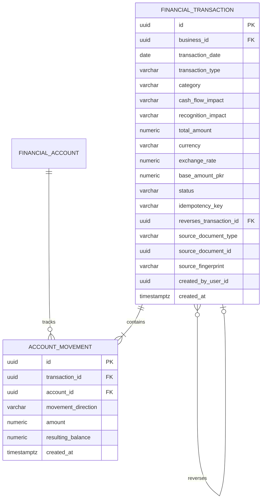

# Contract C01: Transaction Event & Posting Specification (Draft)

**Contract ID:** `C01_POSTING_DRAFT`  
**Version:** `1.1`  
**Date:** 14 October 2026  
**Status:** `DRAFT_PENDING_REVIEW`  
**Owner:** Antigravity (Developer A Backend)  
**Reviewers:** Codex (Developer A Frontend), Fatima (Developer B & AI Orchestration)  
**Target Release:** Wave 1 (`A-W1-02-BE` / `A-W1-02-FE`)  

> [!WARNING]
> This contract is a technical draft proposal undergoing cross-assistant review. It is not approved, frozen, or authorized for implementation.

---

## 1. Revision History & Codex Review Disposition

| Version | Date | Author | Summary of Changes |
| :--- | :--- | :--- | :--- |
| 1.0 | 2026-10-14 | Antigravity | Initial draft proposing event posting, movement directions, and idempotency. |
| 1.1 | 2026-10-14 | Antigravity | **Addressed Codex Mutation Findings M1–M3, M5–M6, M10:** Removed duplicate opening balance formula (M1); separated economic event identity from content hashes (M2); standardized idempotency error codes and authorization on replay (M3); documented cash balance propagation beyond 6-month score window (M5); defined atomic domain rejection for derived negative totals (M6); unified DTO enum naming and supported non-cash recognition (M10); replaced "Approved Rule" with "Proposed Policy"; split sequential fixtures into independent scenarios. |

---

## 2. Domain Model & Event Semantics

The Phase 2 financial posting engine records discrete, immutable economic events that modify account balances and feed monthly financial aggregation.



---

## 3. Financial Policies & Audit Dispositions

### 3.1. Movement Direction (M10: DTO Consistency)
*   **Proposed Policy:** Movements are named explicitly as **`INCREASE`** or **`DECREASE`**.
*   **Disallowed:** Do not label cash outflow as "debit" and inflow as "credit" without a formal chart of accounts and double-entry balance sheet. Full double-entry bookkeeping remains deferred.
*   **Movement Formula:**
    $$\text{Movement Impact} = \begin{cases} + \text{amount} & \text{if } \text{movementDirection} = \text{'INCREASE'} \\ - \text{amount} & \text{if } \text{movementDirection} = \text{'DECREASE'} \end{cases}$$

### 3.2. Single Opening Balance Authority (M1: Opening Authority)
*   **Correction to Formula:** In earlier drafts, formulas ambiguously added both opening balance and an opening movement.
*   **Authoritative Representation:**
    *   The `opening_balance` on `financial_accounts` represents the baseline funds as of `opening_date`.
    *   Subsequent posted transactions create `ACCOUNT_MOVEMENT` rows.
    *   The cached `current_balance` on `financial_accounts` satisfies the exact invariant:
        $$\text{currentBalance} = \text{openingBalance} + \sum_{\text{subsequent}} \text{Movements}_{\text{INCREASE}} - \sum_{\text{subsequent}} \text{Movements}_{\text{DECREASE}}$$
    *   The initialization of an account does **not** generate a second duplicate `INCREASE` movement; the opening balance is stored once as an immutable account attribute.

### 3.3. Separation of Cash Flow vs. Revenue/Expense Recognition (M10)
*   **Proposed Policy:** A cash inflow is **not** automatically revenue, and a cash outflow is **not** automatically an expense. Furthermore, non-cash recognition (such as credit sales or barter) creates recognition events without requiring invented cash movements:
    *   `CUSTOMER_RECEIPT_AGAINST_INVOICE`: Increases cash; settles an existing obligation; **0 revenue** recognized at receipt (revenue recognized upon invoice issuance).
    *   `CUSTOMER_ADVANCE`: Increases cash; increases unearned customer liability; **0 revenue** recognized until goods/services delivered.
    *   `SUPPLIER_PAYMENT_AGAINST_BILL`: Decreases cash; settles existing accounts payable; **0 expense** recognized at payment (expense recognized when bill incurred).
    *   `INTERNAL_TRANSFER`: Decreases source account, increases destination account; **0 cash change business-wide, 0 revenue, 0 expense**.
    *   `DIRECT_REVENUE_SALE`: Increases cash; increases revenue.
    *   `DIRECT_OPERATING_EXPENSE`: Decreases cash; increases operating expenses.
    *   `NON_CASH_ACCRUAL`: Modifies recognized revenue or expense; creates **0 account movements**.

### 3.4. Account Balances Authority & Concurrency Locking (M5: Propagation)
*   **Cached Balance Authority:** `current_balance` on `financial_accounts` is updated atomically within the posting database transaction under a row lock (`SELECT ... FOR UPDATE`).
*   **Backdated Postings & Propagation:**
    *   When a transaction is backdated into month $M$:
        1.  The account `current_balance` is updated immediately.
        2.  Month $M$'s `MonthlyRecord` is re-aggregated.
        3.  **Forward Propagation:** Month-end closing cash (`cashBalanceEom`) is recomputed and propagated forward for all chronological months $M+1, M+2, \dots$ up to the current active month.
        4.  *Note:* This forward cash carry-forward is distinct from the 6-month health score recalculation window (`recalculateAffectedScores`). Cash balance changes propagate through all subsequent months.

### 3.5. Source Identity vs. Content Fingerprints (M2: Source Identity)
*   **Economic Event Identity:** Every economic event possesses a unique client-generated or server-assigned UUID.
*   **Content Fingerprints:** A content hash (e.g. SHA-256 of statement line: date, amount, description) is used strictly for duplicate import detection (`source_fingerprint`).
*   **Legitimate Identical Transactions:** Two legitimate separate cash receipts of 5,000 PKR on the same day from different customers have distinct event IDs and distinct idempotency keys. They are not conflated because content hashing is restricted to imported document statement lines.

### 3.6. Durable Duplicate Prevention & Idempotency (M3: Idempotency)
*   **Persistent Table:** Uniqueness is enforced via `financial_idempotency_records`:
    ```sql
    CREATE TABLE financial_idempotency_records (
        business_id UUID NOT NULL,
        idempotency_key VARCHAR(128) NOT NULL,
        request_hash VARCHAR(64) NOT NULL,
        transaction_id UUID NOT NULL,
        response_status INT NOT NULL,
        response_body JSONB NOT NULL,
        created_at TIMESTAMPTZ NOT NULL DEFAULT now(),
        PRIMARY KEY (business_id, idempotency_key)
    );
    ```
*   **Replay Authorization:** On replay, the active business context and role permission are fully re-evaluated. If the caller's session has changed to another business or the caller lacks permissions, the replay is rejected with HTTP `403 Forbidden` or `404 Not Found`.
*   **Conflict Code:** Replay with mismatched payload returns HTTP `409 Conflict` with error code `ERROR_IDEMPOTENCY_CONFLICT`.

### 3.7. Reversal Policy & Derived Negative Values (M6: Negative Compatibility)
*   **Compensating Reversal:** Posted transactions are immutable. Reversing creates a new transaction referencing `reverses_transaction_id` with inverted movements.
*   **Negative Derived Monthly Values:**
    *   Existing MVP `MonthlyRecord` database constraints require `revenue >= 0` and `cash_inflow >= 0`.
    *   *Proposed Resolution:* If a backdated reversal or refund causes total derived revenue or cash inflow for a month to become negative:
        *   The transaction posting is rejected atomically with HTTP `422 Unprocessable Entity` (`ERROR_DERIVED_NEGATIVE_UNSUPPORTED`).
        *   Silent clamping of negative derived figures to `0.00` is strictly **forbidden**, as it hides financial discrepancies and breaks ledger reconciliation.

---

## 4. Independent Reference Verification Fixtures

Each fixture below defines its own unique initial state, request payload, idempotency key, and expected outcome:

### Fixture 1: Standard Direct Revenue & Expense
*   **Initial State:** Account A has opening balance `"100000.00"` PKR.
*   **Action 1 (Receipt):**
    *   Key: `"idem-fix1-receipt-01"`
    *   Payload: Amount `"20000.00"` PKR, Type `DIRECT_REVENUE`, Category `"Retail Sales"`.
    *   Expected: Account A balance = `"120000.00"`. Month Revenue = `"20000.00"`. Month Inflow = `"20000.00"`.
*   **Action 2 (Payment):**
    *   Key: `"idem-fix1-payment-02"`
    *   Payload: Amount `"5000.00"` PKR, Type `DIRECT_EXPENSE`, Category `"Utility Bill"`.
    *   Expected: Account A balance = `"115000.00"`. Month Expenses = `"5000.00"`. Month Outflow = `"5000.00"`.
*   **Net Month-End Outcome:** Cash Balance EOM = `"115000.00"`. Revenue = `"20000.00"`. Expenses = `"5000.00"`.

### Fixture 2: Inter-Account Transfer (Cash & P&L Neutral)
*   **Initial State:** Account A has `"50000.00"` PKR; Account B has `"20000.00"` PKR. Total business cash = `"70000.00"` PKR.
*   **Action:**
    *   Key: `"idem-fix2-transfer-01"`
    *   Payload: Transfer `"10000.00"` PKR from Account A to Account B.
*   **Expected Outcome:**
    *   Account A balance = `"40000.00"`. Account B balance = `"30000.00"`.
    *   Total business cash = `"70000.00"` (0.00 net change).
    *   Month Revenue change = `"0.00"`. Month Expense change = `"0.00"`.

### Fixture 3: Idempotent Replay vs. Conflict
*   **Initial State:** Account A has `"100000.00"` PKR.
*   **Action 1:** Post transaction with Key `"idem-fix3-test-01"`, Amount `"15000.00"`.
    *   Expected: HTTP `201 Created`. Account A balance = `"115000.00"`.
*   **Action 2 (Identical Replay):** Re-post Key `"idem-fix3-test-01"`, Amount `"15000.00"`.
    *   Expected: HTTP `201 Created` (Cached). Header `X-Idempotency-Replay: true`. Account A balance = `"115000.00"` (no duplicate movement).
*   **Action 3 (Mismatched Conflict):** Post Key `"idem-fix3-test-01"`, Amount `"25000.00"`.
    *   Expected: HTTP `409 Conflict` (`ERROR_IDEMPOTENCY_CONFLICT`). No balance change.

### Fixture 4: Compensating Reversal
*   **Initial State:** Account A has balance `"115000.00"` PKR following a `"5000.00"` PKR expense payment (Tx ID `"tx-fix4-target"`).
*   **Action:** Reverse `"tx-fix4-target"` with Key `"idem-fix4-rev-01"`.
*   **Expected Outcome:**
    *   Reversal transaction created with `reverses_transaction_id = "tx-fix4-target"`.
    *   Movement: `INCREASE` of `"5000.00"` on Account A.
    *   Account A balance = `"120000.00"`.
    *   Re-reversing `"tx-fix4-target"` returns HTTP `409 Conflict` (`ERROR_TRANSACTION_ALREADY_REVERSED`).
